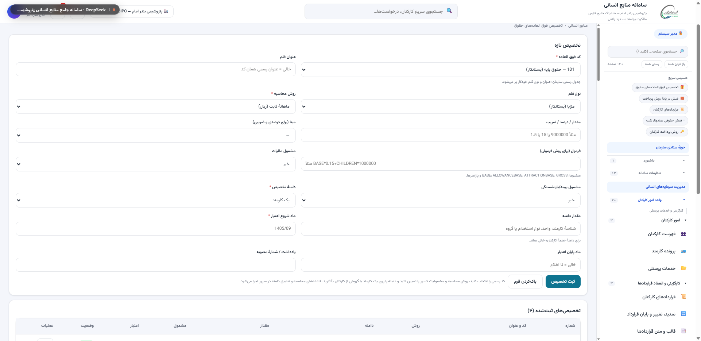
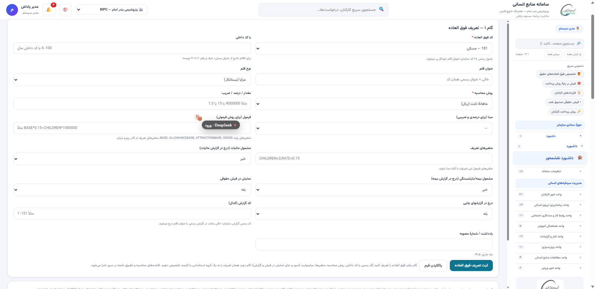
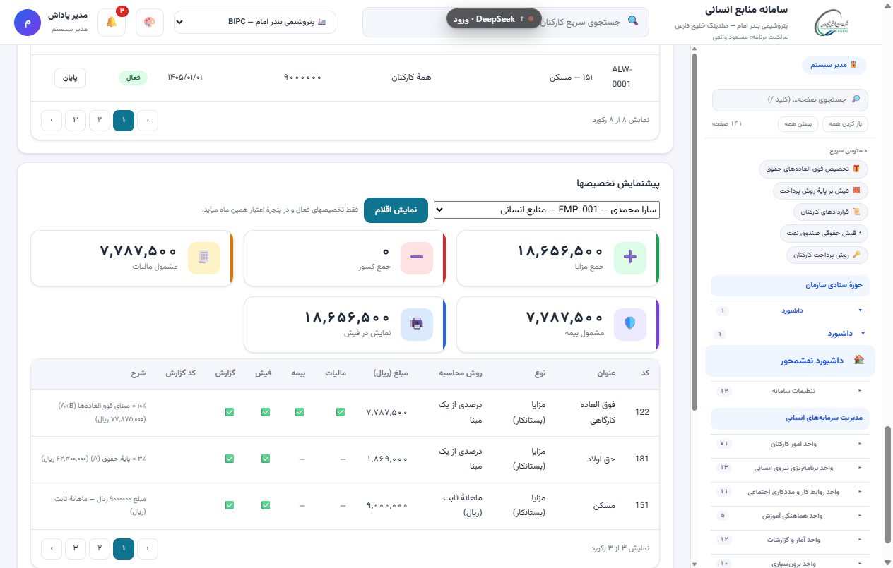

# اسپک تخصیص فوق‌العاده‌های حقوق (کد رسمی، روش محاسبه، دامنه و مشمولیت کسور)

> نسخهٔ ۱.۰ — ۱۴۰۵/۰۹/۰۳
> دامنه: ماژول حقوق و دستمزد (کدهای رسمی «فوق العاده»، تخصیص به کارمند/گروه، محاسبه،
> مشمولیت مالیات و بیمه) و صفحهٔ رابط آن.
> روش: **spec-driven** — بندهای `ASG-xx` همین سند با دروازهٔ `node tools/check/asg-spec.mjs`
> (و `make verify`) ردیابی می‌شوند.

---

## ۱. مسئله

فیش رسمی سازمان هر قلم را با **کد فوق العاده** می‌شناسد (جدول ۲۸ ردیفی مصوب: ۱۰۱ حقوق پایه،
۱۰۲ بدی آب و هوا، ۱۰۴ محرومیت، ۱۲۷ صرف وقت، ۱۴۴ درصد فوق العاده شغل، ۱۰۳ مبلغ جذب، ۱۲۲
کارگاهی، ۱۵۱ مسکن، ۱۸۱ حق اولاد، ۱۵۹ عائله مندی، ۳۵۳ و ۲۱۳ مأموریت، ۵۵۸/۵۵۹ منازل سازمانی،
۳۹۴ مهد کودک، ۳۶۱ حق التدریس، ۶۳۷ تأمین آتیه، ۳۶۴ عیدی، ۳۳۵ پاداش افزایش تولید، وام‌ها
۵۰۰/۵۰۲/۵۱۹/۵۰۳ و اقساطشان ۵۴۰۰/۵۴۰۲، کسور ۵۵۱/۵۵۲/۵۵۷).

پیش از این:
- کد رسمی جایی نگه‌داری نمی‌شد، پس فیش سامانه با فیش رسمی قابل تطبیق نبود؛
- اقلام حقوق فقط «تعریف» می‌شدند و به کارمند یا گروهی از کارکنان **تخصیص** نمی‌یافتند؛
- هیچ‌جا ثبت نمی‌شد که یک قلم مشمول مالیات یا بیمه/بازنشستگی است یا نه.

---

## ۲. طراحی (یک منبع حقیقت، سه لایه)

```
جدول رسمی کدها            rules/payslipcodes.go        ← کد، عنوان، نوع (مزایا/کسور/وام)، کلید قلم
        │
تخصیص (رکورد ASG)         modules/payroll/domain/allowance.go  ← کد + روش محاسبه + مقدار + دامنه + پنجرهٔ اعتبار + مشمولیت
        │
محاسبه و تطبیق دامنه      rules/allowance_assignment.go ← «کدام تخصیص به این کارمند می‌خورد و چقدر»
        │
API                        GET  /api/v1/payroll/allowance-defaults   پیش‌فرض‌ها و جدول کدها
                            POST /api/v1/payroll/allowance-preview    سطرهای تخصیصیافتهٔ یک کارمند
                            GET/POST /api/v1/payroll/records?kind=allowanceAssignment  ثبت/فهرست تخصیص
                            POST /api/v1/payroll/payslip               بلوک assignments کنار فیش
                            GET  /api/v1/payroll/payslip-codes         (همان جدول کدها، از مسیر فیش)
```

**پنج روش محاسبه:** `fixed` ماهانهٔ ثابت ریالی، `once` یک‌بار مرتبه (تنها در ماه شروع اعتبار)،
`percent` درصدی از یک مبنا، `coefficient` ضریب در یک مبنا، `formula` فرمول حسابی با متغیرها
(BASE، ALLOWANCEBASE، ATTRACTIONBASE، GROSS، پارامترهای شرکت و متغیرهای محیط).

**دامنهٔ تخصیص:** یک کارمند، یک واحد سازمانی، یک نوع استخدام، یک گروه شغلی، یک گروه نظام
پرداخت نفت، یا همهٔ کارکنان.

**مشمولیت کسور:** هر تخصیص دو پرچم دارد — `taxable` (مشمول مالیات) و `insured` (مشمول بیمه و
بازنشستگی) — و جمع‌های مشمول در پیش‌نمایش و پاسخ فیش گزارش می‌شود.

**جای نمایش قلم:** هر تخصیص سه فیلد دیگر هم دارد و تصمیم می‌گیرد قلم کجا دیده شود:

| فیلد | معنا | پیش‌فرض خالی |
| --- | --- | --- |
| `showOnPayslip` | نمایش در فیش حقوقی | بله |
| `showInReports` | درج در گزارش‌های چاپی | بله |
| `reportCode` | کد رسمی گزارش (کدال) — فقط حرف و رقم، حداکثر ۲۰ نویسه | بدون کد |

پاسخ پیش‌نمایش و فیش سه فهرست می‌دهد: `lines` (همهٔ سطرها)، `payslipLines` (فقط اقلام
«نمایش در فیش») و `reportLines` (فقط اقلام «درج در گزارش»)؛ جمع‌ها هم به تفکیک
`payslipEarnings/payslipDeductions` و `reportEarnings/reportDeductions` گزارش می‌شوند.
تصمیم نمایش در خودِ سند است و UI فقط آن را نشان می‌دهد.

### ۲٫۴ ترتیب کار: گام یکم تعریف ⟵ گام دوم تخصیص

کار سازمان دو گام است و سامانه هم همان دو گام را جدا نگه می‌دارد:

| گام | سند (رکورد) | چه چیزی تعیین می‌شود |
| --- | --- | --- |
| **گام ۱ — تعریف فوق العاده** | `allowanceDefinition` (پیشوند `ALD`) | کد رسمی جدول یا کد داخلی، عنوان، نوع قلم (مزایا/کسور)، روش محاسبه، مقدار پیش‌فرض، مبنا، فرمول، **متغیرها** (`vars` مثل `CHILDREN=2, RATE=0.15`)، مشمولیت مالیات و بیمه، نمایش در فیش، درج در گزارش‌ها و کد گزارش |
| **گام ۲ — تخصیص** | `allowanceAssignment` (پیشوند `ALW`) | ارجاع به تعریف (`definition`)، دامنه (گروه استخدامی، کارمند، واحد، گروه شغلی، گروه نظام پرداخت یا همه)، پنجرهٔ اعتبار، و بازنویسی اختیاری مقدار/مبنا (`rateOverride`/`basisOverride`) |

قاعده‌های محاسبه در `rules` است و یک‌جا انجام می‌شود: تخصیص با تعریفش یکی می‌شود
(`MergeAllowanceDefinition`)، متغیرهای تعریف به محیط محاسبه اضافه می‌گردند (متغیر درخواست
مقدم است) و مبلغ نهایی از روش محاسبهٔ تعریف می‌آید. تغییر نرخ یا فرمول در گام ۱، همهٔ
تخصیص‌های وابسته را به‌روز می‌کند.

**سازگاری:** تخصیص‌هایی که پیش از این بدون تعریف ثبت شده‌اند (کد و روش محاسبه در خودشان)
دست‌نخورده می‌مانند و همان‌گونه حساب می‌شوند؛ اگر تعریف یک تخصیص پیدا نشود، سطر با توضیح
صریح «تعریف یافت نشد» گزارش می‌شود و بی‌صدا حذف نمی‌گردد.

---

## ۳. جدول رسمی کدهای فوق العاده (۲۸ ردیف)

| کد | عنوان | نوع | کلید قلم در سامانه |
| --- | --- | --- | --- |
| 101 | حقوق پایه | بستانکار | `baseSalary` |
| 102 | بدی آب و هوا | بستانکار | `badClimate` |
| 104 | محرومیت از تسهیلات زندگی | بستانکار | `deprivation` |
| 127 | جبران صرف وقت اضافی | بستانکار | `timeConsumed` |
| 144 | درصد فوق العاده شغل | بستانکار | `attractionSpecialty` |
| 103 | مبلغ فوق العاده جذب | بستانکار | `attraction` (در موتور نفت پیاده نشده) |
| 122 | فوق العاده کارگاهی | بستانکار | `workshop` |
| 151 | مسکن | بستانکار | `housing` |
| 181 | حق اولاد | بستانکار | `children` |
| 159 | عائله مندی | بستانکار | `family` |
| 353 | فوق العاده ماموریت | بستانکار | `mission` |
| 558 | هزینه نگهداشت منازل سازمانی | بستانکار | `orgHousing` |
| 394 | کمک هزینه مهد کودک | بستانکار | `kindergarten` |
| 361 | حق التدریس ساعتی | بستانکار | `hourlyTeaching` |
| 637 | صندوق تامین آتیه کارمندان | کسور | `futureFund` |
| 559 | هزینه عوارض برق منازل سازمانی | کسور | `orgHousingPower` |
| 213 | فوق العاده ماموریت موقت داخل کشور | بستانکار | `missionDomestic` |
| 364 | پاداش نوروزی /عیدی | بستانکار | `nowruzBonus` |
| 335 | پاداش افزایش تولید پتروشیمی | بستانکار | `productionBonus` |
| 500 | وام اضطراری | وام | `loanEmergency` |
| 502 | وام پس انداز | وام | `loanSavings` |
| 519 | وام مددکاری | وام | `loanSocialWork` |
| 503 | وام شرکتی (دوبرابر حقوق) | وام | `loanCompany` |
| 551 | بازنشستگی سهم کارمند | کسور | `fundEmployee` |
| 552 | پس انداز سهم کارمند | کسور | `savingsEmployee` |
| 557 | مالیات بر درآمد | کسور | `tax` |
| 5400 | کسر اقساط وام اضطراری | کسور | `loanInstallmentEmergency` |
| 5402 | کسر اقساط وام پس انداز | کسور | `loanInstallmentSavings` |

اقلام موتور که در این جدول کد ندارند (نوبتکاری، اضافه‌کاری، بیمهٔ سهم کارمند، فوق‌العادهٔ
ویژه، ترمیم حقوق، تفاوت تطبیق، مزد رتبه/سنوات/پست/ایثارگری و …) با تابع
`PayslipCodeGaps()` صریح گزارش می‌شوند تا «قلم بی‌کد» پنهان نماند.

---

## ۴. بندهای نیازمندی

| شناسه | نیازمندی | پیاده‌سازی | تأیید |
| --- | --- | --- | --- |
| ASG-01 | جدول رسمی کدهای فوق العاده با کد، عنوان، نوع قلم و نگاشت به کلید سامانه نگه‌داری شود؛ کد با ارقام فارسی/صفر ابتدایی هم یافت شود و شکاف‌های کد صریح گزارش گردد. | `rules/payslipcodes.go` | go:TestASG01PayslipCodeCatalog |
| ASG-02 | دامنهٔ تخصیص شش‌گانه (کارمند، واحد، نوع استخدام، گروه شغلی، گروه نظام پرداخت، همه) با تطبیق دقیق پشتیبانی شود. | `rules/allowance_assignment.go` | go:TestASG02TargetMatching |
| ASG-03 | پنج روش محاسبه (ثابت ماهانه، یک‌بار مرتبه، درصدی، ضریبی، فرمولی) با مبنای انتخابی و پرچم مشمولیت مالیات/بیمه محاسبه و جمع‌بندی شود؛ پنجرهٔ اعتبار و «یک‌بار مرتبه» درست اعمال گردد. | `rules/allowance_assignment.go` | go:TestASG03ResolveCalculation |
| ASG-04 | ورودی ناقص/ناسازگار تخصیص (کد نامعتبر، مقدار صفر، نبود مبنا، فرمول بدشکل، دامنهٔ بی‌مقدار، ماه نامعتبر) با خطای فیلدبه‌فیلد رد شود. | `rules/allowance_assignment.go` | go:TestASG04Validation |
| ASG-05 | جدول کدها و فهرست‌های مرجع فرم (روش‌ها، مبناها، دامنه‌ها، کارکنان با ویژگی‌های تطبیق) از API در دسترس باشد. | `modules/payroll/allowance.go` | go:TestASG05AllowanceDefaults |
| ASG-06 | پیش‌نمایش تخصیص برای یک کارمند، سطرهای تخصیص‌یافته با کد، عنوان، روش، مبلغ و مشمولیت کسور و جمع‌های تفکیکی برگرداند. | `modules/payroll/allowance.go` | go:TestASG06AllowancePreview |
| ASG-07 | ثبت تخصیص از مسیر رکوردها کار کند، عنوان/نوع قلم از جدول رسمی پر شود، فعال‌سازی اثرگذار باشد و ورودی ناقص ۴۲۲ بگیرد. | `modules/payroll/domain/allowance.go` | go:TestASG07AssignmentRecordValidation |
| ASG-08 | بلوک تخصیص‌ها کنار فیش (`assignments`) بیاید تا جمع مزایا/کسور و مشمولیت‌ها کنار فیش دیده شود. | `modules/payroll/payslip.go` | go:TestASG08PayslipAssignmentsBlock |
| ASG-09 | صفحهٔ رابط «تخصیص فوق العاده‌های حقوق» با فرم تخصیص، فهرست و پیش‌نمایش ارائه شود (با کامپوننت RN متناظر و بازتولید خروجی‌ها). | `design/prototype/js/live_allowance.js`، `module.json` | go:TestASG09AllowanceScreenRegistered |
| ASG-10 | جای نمایش هر قلم تخصیص تعیین شود: نمایش در فیش حقوقی، درج در گزارش‌های چاپی و کد گزارش رسمی (کدال)؛ جمع‌ها به تفکیک فیش/گزارش محاسبه شوند و کد گزارش نامعتبر رد شود. | `rules/allowance_assignment.go` | go:TestASG10ReportingFlags |
| ASG-11 | پرچم‌های نمایش روی رکورد تخصیص ذخیره شوند (خالی = بله) و بلوک فیش سه فهرست `lines`/`payslipLines`/`reportLines` را با پرچم و کد گزارش بدهد. | `modules/payroll/domain/allowance.go`، `modules/payroll/allowance.go` | go:TestASG11PayslipVisibility |
| ASG-12 | **گام یکم — تعریف فوق العاده**: قلم جدا از تخصیص تعریف شود (کد رسمی یا کد داخلی، نوع قلم، روش محاسبه، مقدار/مبنا/فرمول، متغیرها، مشمولیت مالیات و بیمه، جای نمایش و کد گزارش) و ورودی نامعتبر فیلدبه‌فیلد رد شود. | `rules/allowance_assignment.go`، `modules/payroll/domain/allowance_definition.go` | go:TestASG12AllowanceDefinition |
| ASG-13 | **گام دوم — تخصیص تعریف**: تخصیص با تعریفش یکی شود، بازنویسی مقدار/مبنا اثر کند، متغیرهای تعریف به محاسبه برسند، نبود تعریف صریح گزارش شود و تخصیص‌های قدیمی (درون‌خطی) دست‌نخورده بمانند. | `rules/allowance_assignment.go` | go:TestASG13DefinitionMerge |
| ASG-14 | تعریف‌ها (با شمار تخصیص، متغیرها و وضعیت) در API پیش‌فرض‌ها بیایند و ثبت/فعال‌سازی تعریف با کد داخلی و متغیر از مسیر رکوردها کار کند. | `modules/payroll/allowance.go` | go:TestASG14DefinitionFlow |
| ASG-15 | تخصیص تعریف به گروه استخدامی و به یک کارمند کار کند: مبلغ از تعریف بیاید، بازنویسی مقدار اثر کند و بلوک فیش همان سطر تعریف‌محور (با `definitionId`) را نشان دهد. | `modules/payroll/allowance.go`، `modules/payroll/payslip.go` | go:TestASG15GroupAssignment |
| ASG-16 | صفحهٔ رابط با ترتیب دو گامی ساخته شود: کارت «گام ۱ — تعریف فوق العاده» (با متغیرها) → فهرست تعریف‌ها → کارت «گام ۲ — تخصیص به گروه استخدامی یا افراد» → فهرست تخصیص‌ها → پیش‌نمایش. | `design/prototype/js/live_allowance.js` | file:design/prototype/js/live_allowance.js |
| ASG-17 | هم‌پوشانی تخصیص‌ها (یک قلم از دو تخصیص فعال برای یک کارمند، چه تعریف‌محور چه قدیمی) در پیش‌نمایش و فیش هشدار داده شود تا مبلغ بی‌صدا دوبار حساب نشود. | `rules/allowance_assignment.go`، `modules/payroll/allowance.go` | go:TestASG17OverlapWarning |

---

## ۵. راستی‌آزمایی زنده (سرور محلی `127.0.0.1:8099`)



| سنجه | نتیجهٔ دیده‌شده |
| --- | --- |
| `GET /api/v1/payroll/allowance-defaults` | ۲۸ کد رسمی، ۵ روش محاسبه، ۶ مبنا، ۶ دامنه، ۱۲ کارمند با ویژگی تطبیق، دورهٔ جاری و شکاف‌های کد |
| `POST /api/v1/payroll/allowance-preview` (EMP-001) | کد ۱۸۱ = ۱٬۸۶۹٬۰۰۰ ریال، کد ۱۵۱ = ۹٬۰۰۰٬۰۰۰ ریال |
| ثبت و فعال‌سازی `ALW-0004` (کد ۱۲۲ کارگاهی، ۱۰٪ مبنای فوق العاده) | پیش‌نمایش: کد ۱۲۲ = ۷٬۷۸۷٬۵۰۰ ریال مشمول مالیات و بیمه؛ جمع مزایا ۱۸٬۶۵۶٬۵۰۰، جمع مشمول ۷٬۷۸۷٬۵۰۰ |
| بلوک `assignments` در پاسخ فیش | ۲ سطر با کد، عنوان، روش، مبلغ و مشمولیت |
| صفحهٔ رابط «تخصیص فوق العاده‌های حقوق» | ۲۸ گزینهٔ کد، ۴ سطر تخصیص، کارت‌های پیش‌نمایش و جدول اقلام درست رندر شد |
| پرچم‌های نمایش قلم (۱۴۰۵/۰۹) | قلم ۳۶۴ با «نمایش در فیش = خیر، درج در گزارش = بله، کد گزارش ۳۶۴-R» ثبت شد: سطرهای فیش سه قلم (۱۲۲، ۱۸۱، ۱۵۱) و سطرهای گزارش چهار قلم (شامل ۳۶۴) شد؛ جمع نمایش در فیش ۱۷٬۵۲۵٬۰۰۰ و جمع گزارش ۲۰٬۵۲۵٬۰۰۰ ریال |
| دو گام کار (۱۴۰۵/۰۹) | پنج تعریف فعال در فهرست گام ۱ (شامل قلم بی‌کد رسمی `X-100` با فرمول `BASE*CHILDREN` و متغیر `CHILDREN=2`)؛ تخصیص تعریف ALD-0002 به گروه استخدامی رسمی نفت و تعریف ALD-0005 به یک کارمند |
| پیش‌نمایش پس از گام دوم | EMP-001 (رسمی نفت): سه سطر ۱۲۲ = ۷٬۷۸۷٬۵۰۰ (۱۰٪ مبنای فوق‌العاده‌ها)، ۱۸۱ = ۱٬۸۶۹٬۰۰۰ و ۱۵۱ = ۹٬۰۰۰٬۰۰۰ — جمع مزایا ۱۸٬۶۵۶٬۵۰۰ ریال؛ EMP-003: قلم داخلی `X-100` = ۶۸٬۰۰۰٬۰۰۰ ریال از فرمول `BASE*CHILDREN` |
| هشدار هم‌پوشانی | پیش از پاک‌سازی، قلم‌های ۱۲۲ و ۱۸۱ هر یک از دو تخصیص فعال می‌آمدند و پیش‌نمایش دو هشدار داد («... از ۲ تخصیص فعال ... یکی را پایان دهید»)؛ پس از پایان دادن تخصیص تکراری، هشدار صفر شد |





---

## ۶. کارهای باز (آگاهانه)

1. **ورود جمع تخصیص‌ها به محاسبهٔ کسور قانونی**: اکنون سطرهای تخصیص در پاسخ فیش گزارش
   می‌شوند و جمع مزایا/کسور و مشمولیتشان را می‌دهند؛ افزودن «درآمد مشمول مالیات/بیمهٔ
   تخصیص‌ها» به مبنای محاسبهٔ بیمه و مالیات موتور، کار بعدی است.
2. **اقلام بی‌کد رسمی**: قلم‌هایی مثل نوبتکاری، اضافه‌کاری و بیمهٔ سهم کارمند در جدول رسمی
   کد ندارند؛ در گام ۱ می‌توان برایشان «کد داخلی» (مثل `X-100`) تعریف کرد و در فیش و گزارش
   با همان عنوان می‌آید، ولی کد رسمی مالی/بیمه برایشان صادر نمی‌شود و در پاسخ `codeOfficial=false`
   است. اگر جدول رسمی کامل‌تری برسد، همان‌جا کد رسمی می‌نشیند.
3. **تخصیص گروهی زمان‌دار برای آینده**: پنجرهٔ اعتبار روی ماه کار می‌کند؛ اعمال خودکار از
   ماه مشخص (زمان‌بند) موضوع کار بعدی است.
