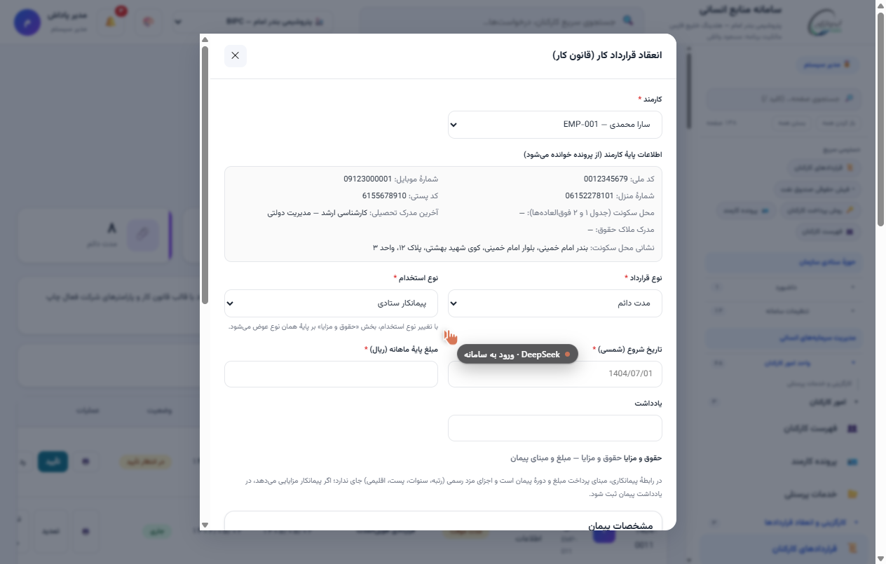

# اسپک زیرفرم «حقوق و مزایا» بر پایهٔ نوع استخدام و قرارداد

> نسخهٔ ۱.۰ — ۱۴۰۵/۰۹/۰۱
> دامنه: ماژول `contracts` (سرور)، فرم قرارداد در رابط وب، و ستون‌های ذخیره‌سازی قرارداد.
> روش: **spec-driven** — بندهای `CPF-xx` همین سند با دروازهٔ `node tools/check/cpf-spec.mjs`
> (و `make verify`) ردیابی می‌شوند.

---

## ۱. مسئله

بخش «حقوق و مزایا»ی قرارداد برای هر نوع استخدام شکل دیگری دارد:

| نوع استخدام (نمونه) | خانوادهٔ پرداخت | زیرفرمی که باید نمایش داده شود |
| --- | --- | --- |
| کارمند رسمی نفت، کارگر رسمی، مدت معین ۱۶۶۲/هلدینگ، قراردادی طویل‌المدت | `official` | جدول مزد رسمی: اجزای ثابت مزد، تفاوت تطبیق، منطقهٔ اقلیمی و ضرایب |
| پیمانکار ستادی/پروژه‌ای/جاری | `contracting` | مشخصات پیمان + مبنای پرداخت (روزمزد/ساعت‌مزد/ماهانه/مقطوع)، بیمه، مرجع پرداخت |
| مأمور به/از سایر شرکت‌ها | `secondment` | طرفین مأموریت، بازه، ترتیب پرداخت و سهم شرکت مبدأ |

پیش از این، فرم همیشه «جدول مزد رسمی» را نشان می‌داد؛ نتیجه: کاربرِ قرارداد پیمانکاری هم
فیلدهای مزد رسمی را می‌دید و می‌توانست عددهای بی‌معنا ثبت کند که فیش حقوق را آلوده می‌کرد.

---

## ۲. قاعدهٔ طراحی (یک منبع حقیقت)

```
دامنهٔ contracts (domain/payform.go)
        │  تعریف زیرفرم + اعتبارسنجی
        ├──────────────► GET /api/v1/contracts/forms   ──►  رابط: فقط می‌کشد و می‌فرستد
        └──────────────► POST/PATCH /contracts/contracts ──► سرور: همان تعریف را اعتبارسنجی می‌کند
```

- هیچ قاعدهٔ کسب‌وکاری در UI نیست (هم‌راستا با `AGENTS.md`).
- کلید فیلدها در دو جا می‌نشیند: اجزای مزد رسمی در ستون‌های ثابت (مهاجرت ۰۰۰۲) و فیلدهای
  پیمان/مأموریت در ستون تازهٔ `pay_meta JSONB` (مهاجرت ۰۰۰۳) همراه `pay_family`.
- در خانواده‌های غیررسمی، اجزای مزد رسمی **رد** می‌شود (نه فقط پنهان)؛ پس فراخوان مستقیم
  API هم نمی‌تواند دادهٔ بی‌معنا بنشاند.

---

## ۳. بندهای نیازمندی

| شناسه | نیازمندی | پیاده‌سازی | تأیید |
| --- | --- | --- | --- |
| CPF-01 | خانوادهٔ پرداخت از نوع استخدام استخراج شود (کلید لاتین یا عنوان فارسی)، پیمانکارها به `contracting` و مأموریت‌ها به `secondment` و بقیه (و نوع ناشناخته) به `official` نگاشت شوند. | `contracts/domain/payform.go` | go:TestCPF01PayFamilyMapping |
| CPF-02 | برای هر خانواده یک زیرفرم سرور-محور تعریف شود: گروه‌بندی فیلدها، برچسب فارسی، نوع (مبلغ/درصد/تاریخ/متن/فهرست)، الزامی‌بودن، واحد و راهنما؛ و مشخص باشد کدام خانواده «جدول مزد رسمی» دارد. | `domain/payform.go`، `api/handler.go` | go:TestCPF02PayFormPerFamily |
| CPF-03 | همان تعریف در ثبت و ویرایش قرارداد اعتبارسنجی شود: الزامی‌ها، قید شرطی (سهم شرکت مبدأ وقتی پرداخت تقسیمی است) و ممنوعیت اجزای مزد رسمی در خانواده‌های غیررسمی؛ پاسخ ۴۲۲ فیلدبه‌فیلد فارسی. | `domain/payform.go`، `app/service.go` | go:TestCPF03PayFormValidation، go:TestCPF05ContractFormsAPI |
| CPF-04 | دامنهٔ مقادیر سنجیده شود: درصد بین ۰ و ۱۰۰ (نسبت ۰..۱ در داده) و مقدار فهرست‌های انتخابی فقط از گزینه‌های اعلام‌شده. | `domain/payform.go` | go:TestCPF04PayFormBounds |
| CPF-05 | زیرفرم‌ها و نگاشت نوع استخدام↔خانواده از `GET /api/v1/contracts/forms` در دسترس باشد (با کنترل دسترسی) و قرارداد تازه خانواده و فراداده را در پاسخ برگرداند. | `api/handler.go`، `module.go`، `infra/postgres.go` | go:TestCPF05ContractFormsAPI |
| CPF-06 | رابط وب زیرفرم را بر پایهٔ انتخاب کاربر (نوع قرارداد/نوع استخدام) دوباره بکشد و فقط فیلدهای همان خانواده را بفرستد؛ بدون هیچ قاعدهٔ محلی. | `design/prototype/js/live.js` | doc:docs/contract-pay-form-spec-fa.md#رابط-کاربری |

---

## ۴. رابط کاربری

`design/prototype/js/live.js`:

- `liveContractForms()` — یک‌بار `/api/v1/contracts/forms` را می‌گیرد و کش می‌کند.
- `liveContractPayMount('ct', values)` — ظرف `#ctPaySection` را با زیرفرم خانوادهٔ انتخاب‌شده پر می‌کند
  (خانوادهٔ رسمی همان بلوک «اجزای ثابت مزد» قبلی است، پس شناسه‌های `ctRank…ctExtraTime` دست‌نخورده می‌مانند).
- `onchange="liveContractPayRefresh()"` روی فهرست «نوع استخدام» — تغییر نوع، زیرفرم را عوض می‌کند.
- `livePayPayload('ct', family, form)` — بدنهٔ API: در خانوادهٔ رسمی اجزای مزد، در بقیه `payMeta`.

**تأیید زنده در مرورگر** (اجرای واقعی روی `http://127.0.0.1:8099` با نقش `admin`):

| انتخاب نوع استخدام | عنوان زیرفرم | فیلدهای موجود در DOM |
| --- | --- | --- |
| `official_oil` | حقوق و مزایا — جدول مزد رسمی | `ctRegion, ctRank, ctSeniority, ctPost, ctSacrifice, ctClimate, ctRepair, ctPayGap, ctPayGapSince, ctBadClimate, ctDeprivation, ctRegionHardship, ctExtraTime` |
| `contractor_staff` | حقوق و مزایا — مبلغ و مبنای پیمان | `ctMeta_contractorName, ctMeta_contractNo, ctMeta_contractSubject, ctMeta_projectName, ctMeta_payBasis, ctMeta_payAmount, ctMeta_insurancePayer, ctMeta_paymentSource, ctMeta_invoiceNo, ctMeta_payNote` |
| `seconded_to` | حقوق و مزایا — تفاهم‌نامهٔ پرداخت (مأموریت) | `ctMeta_hostCompany, ctMeta_hostContact, ctMeta_missionStart, ctMeta_missionEnd, ctMeta_salaryPayer, ctMeta_originSharePercent, ctMeta_allowancesPayer, ctMeta_missionNote` |

نمای پیمانکاری (فیلدهای مزد رسمی به‌کل نمایش داده نمی‌شوند):



---

## ۵. آزمون‌های خودکار و نتیجهٔ اجرا

```bash
cd server && go test ./internal/modules/contracts/... ./internal/bootstrap/
node tools/check/cpf-spec.mjs
```

| آزمون | نتیجه |
| --- | --- |
| `TestCPF01PayFamilyMapping` | ✅ نگاشت ۱۰ حالت (کلید/عنوان/ناشناخته) |
| `TestCPF02PayFormPerFamily` | ✅ سه زیرفرم، الزامی‌های پیمان، شرطی‌بودن سهم مبدأ |
| `TestCPF03PayFormValidation` | ✅ الزامی‌ها، رد اجزای رسمی در پیمانکاری/مأموریت، مبلغ صفر |
| `TestCPF04PayFormBounds` | ✅ درصد > ۱۰۰ و گزینهٔ ناشناخته رد شد |
| `TestCPF05ContractFormsAPI` | ✅ فرم‌ها ۲۰۰/۴۰۱، پیمانکاری ناقص ۴۲۲، ثبت کامل ۲۰۱ با `payFamily=contracting` |
| بررسی زندهٔ API | ✅ سه خانواده، ۳۱ ماژول سالم، مهاجرت‌ها ۱۸ |
| بررسی زندهٔ چرخهٔ کامل (Postgres) | ✅ ثبت قرارداد پیمانکار پروژه‌ای برای `EMP-012` با کد ۲۰۱ → `CT-1405-0200`، خانواده `contracting`، `payMeta.contractNo=P-1405-77`، `payBasis=daily`، `payAmount=1150000`، خواندن دوباره از پایگاه‌داده همان مقادیر، اجزای مزد رسمی خالی، حذف ۲۰۴ |
| بررسی زندهٔ رابط (مرورگر) | ✅ سه زیرفرم مطابق جدول بخش ۴؛ تغییر نوع با رویداد واقعی کاربر: `official` (۱۳ فیلد) → `contractor_staff` (۱۰ فیلد) |
| قانون همپوشانی قرارداد | ✅ در همین آزمون، ثبت روی کارمندی که قرارداد جاری دارد با ۴۲۲ و پیام فارسی رد شد |

---

## ۶. کارهای باز

1. **متن قرارداد چاپی** برای هر خانواده جداگانه تنظیم شود (قالب پیمان/مأموریت با بندهای خودش).
2. **فیش حقوق پیمانکاری**: نگاشت `payBasis` (روزمزد/ساعت‌مزد) به اقلام حضور و کارکرد در ماژول حقوق.
3. **مهاجرت دادهٔ موجود**: قراردادهای فعلی همه از خانوادهٔ رسمی‌اند؛ مقدار پیش‌فرض `pay_family='official'` گرفته‌اند.
