# فرهنگ داده — hrms_ops

> این سند **تولیدشده** و «پایدار» است (بدون مُهر زمان و بدون شمار سطرها) تا با تغییر داده کهنه نشود.
> برای بروزرسانی پس از هر مهاجرت، فرمان بازتولید را اجرا کنید.

| شاخص | شمار |
| --- | --- |
| طرح‌ها | 8 |
| جدول‌ها | 20 |
| ستون‌ها | 229 |
| روابط خارجی | 8 |
| سطرهای داده | — (در نسخهٔ پایدار شمرده نمی‌شود؛ خروجی زندهٔ API آن را می‌دهد) |

## ماژول‌ها و دادهٔ ذخیره‌شده

| ماژول | عنوان | پیشوند API | طرح داده | موجودیت‌ها | جدول‌ها |
| --- | --- | --- | --- | --- | --- |
| `archive` | بایگانی و شناسایی کارکنان | `/api/v1/archive` | `hr_archive` | PersonnelFile, EmployeeIdentity, ArchiveDocument, FileLending | 0 |
| `attendance` | حضور و غیاب، مرخصی و ماموریت | `/api/v1/attendance` | `hr_attendance` | AttendanceRecord, LeaveRequest, LeaveBalance, Overtime, Shift, Mission | 0 |
| `bonus` | پاداش‌ها | `/api/v1/bonus` | `hr_bonus` | BonusPayment, BonusAllocation | 0 |
| `cards` | کارت‌های رفاهی و شارژ (پتروکارت، نفت‌کارت) | `/api/v1/cards` | `hr_cards` | CardRate, CardBeneficiary, CardCharge, Occasion, ChargeFile | 0 |
| `career` | انتصابات، ترفیعات و کارراههٔ شغلی | `/api/v1/career` | `hr_career` | Appointment, Promotion, CareerPath, SuccessionPlan | 0 |
| `compensation` | نظام جبران خدمات ۴پی | `/api/v1/compensation` | `hr_compensation` | CompensationModel, JobPricing, CompetencyLevel, PerformanceFactor, PayBand, CompensationDecision, G20Index, G20Assessment | 0 |
| `contracts` | کارگزینی و انعقاد قراردادها | `/api/v1/contracts` | `hr_contracts` | Contract, ContractTemplate, ContractRenewal | 2 |
| `dashboard` | داشبورد | `/api/v1/dashboard` | `hr_dashboard` | StatWidget, TrendPoint | 0 |
| `discipline` | کمیتهٔ انضباط کار | `/api/v1/discipline` | `hr_discipline` | DisciplineCase, DisciplineMeeting, DisciplineRuling | 0 |
| `education_bonus` | پاداش تحصیلی فرزندان ممتاز | `/api/v1/education_bonus` | `hr_education_bonus` | OutstandingStudent, BonusLevelRate, BonusFile | 0 |
| `employee` | امور کارکنان | `/api/v1/employee` | `hr_employee` | Employee, Department, Contract, PersonnelServiceRequest | 7 |
| `grievances` | شکایات و امور ایثارگران | `/api/v1/grievances` | `hr_grievances` | Complaint, ComplaintFollowUp, VeteranRecord, VeteranCommitteeDecision, VeteranCommitteeMember | 0 |
| `hrstudies` | مطالعات منابع انسانی | `/api/v1/hrstudies` | `hr_studies` | StudyProject, Survey, HrIndex, Suggestion | 0 |
| `jobclass` | طبقه‌بندی مشاغل | `/api/v1/jobclass` | `hr_jobclass` | JobCategory, JobEvaluation, JobDescription | 0 |
| `loans_retirement` | امور وام و بازنشستگی | `/api/v1/loans` | `hr_loans` | LoanRequest, LoanInstallment, RetirementFile, LoanFund | 0 |
| `medical` | درمان، معاینات دوره‌ای و خدمات درمانی | `/api/v1/medical` | `hr_medical` | MedicalService, TreatmentCase, PeriodicExam, SupplementaryInsurance | 0 |
| `orgstructure` | ساختار سازمانی و تشکیلات | `/api/v1/orgstructure` | `hr_orgstructure` | OrgUnit, Position, OrgChartVersion | 0 |
| `outsourcing` | برون‌سپاری و نیروهای ارکان ثالث | `/api/v1/outsourcing` | `hr_outsourcing` | Contractor, ThirdPartyWorker, OutsourcePayRun, HardshipFile | 0 |
| `payroll` | حقوق و دستمزد (جبران خدمات) | `/api/v1/payroll` | `hr_payroll` | PayRun, Payslip, PayItem, PayFormula, Karana, EmployeePayModel | 0 |
| `performance` | مدیریت عملکرد | `/api/v1/performance` | `hr_performance` | PerfCycle, PerfForm, KpiItem, PerfResult | 0 |
| `recruitment` | تأمین و جذب نیرو | `/api/v1/recruitment` | `hr_recruitment` | HiringRequest, JobPosting, Candidate, Application | 0 |
| `reports` | گزارش‌ها | `/api/v1/reports` | `hr_reports` | ReportDefinition, ReportRun, ExportJob | 0 |
| `salary_admin` | احکام حقوق و گواهی اشتغال | `/api/v1/salary_admin` | `hr_salary_admin` | SalaryDecree, SalaryDecreeLine, EmploymentCertificate | 2 |
| `settings` | تنظیمات | `/api/v1/settings` | `hr_settings` | User, Role, Permission, OrgUnit, SysParam, CatalogItem, AuditEvent | 1 |
| `socialwork` | مددکاری اجتماعی | `/api/v1/socialwork` | `hr_socialwork` | SocialWorkCase, AidRequest, CounselingSession | 0 |
| `sports` | امور ورزش | `/api/v1/sports` | `hr_sports` | SportsProgram, SportsEvent | 0 |
| `staff_services` | افراد تحت تکفل و درخواست پرواز | `/api/v1/personnel` | `hr_personnel` | Dependent, DependentInsurance, FlightRequest | 2 |
| `staffing_moves` | جابه‌جایی و معرفی کارکنان | `/api/v1/moves` | `hr_staffing_moves` | TransferRequest, EmployeeIntroduction | 0 |
| `statistics` | آمار و پایش اطلاعات پایه | `/api/v1/statistics` | `hr_statistics` | StatSnapshot, DataApproval, BaseDataCheck | 0 |
| `training` | هماهنگی آموزش | `/api/v1/training` | `hr_training` | Course, Enrollment, Certificate, Skill, SkillGap | 0 |
| `welfare` | رفاه، سرویس مدارس و اسکان | `/api/v1/welfare` | `hr_welfare` | Facility, WelfareRequest, Loan | 0 |

## hr_contracts — کارگزینی و انعقاد قراردادها

### `hr_contracts.contract`

| ستون | نوع | معنای نوع | تهی‌پذیر | پیش‌فرض | کلید | توضیح |
| --- | --- | --- | --- | --- | --- | --- |
| `id` | `text` | متنی بلند | خیر | — | PK | — |
| `employee_id` | `text` | متنی بلند | خیر | — |  | — |
| `employee_name` | `text` | متنی بلند | خیر | — |  | — |
| `department_name` | `text` | متنی بلند | خیر | ''::text |  | — |
| `position_title` | `text` | متنی بلند | خیر | ''::text |  | — |
| `kind` | `text` | متنی بلند | خیر | — |  | — |
| `start_date` | `text` | متنی بلند | خیر | — |  | — |
| `end_date` | `text` | متنی بلند | خیر | ''::text |  | — |
| `monthly_salary` | `bigint` | عدد صحیح بزرگ | خیر | — |  | — |
| `status` | `text` | متنی بلند | خیر | — |  | — |
| `supersedes_id` | `text` | متنی بلند | خیر | ''::text |  | — |
| `renew_count` | `integer` | عدد صحیح | خیر | 0 |  | — |
| `note_fa` | `text` | متنی بلند | خیر | ''::text |  | — |
| `created_by` | `text` | متنی بلند | خیر | ''::text |  | — |
| `decided_by` | `text` | متنی بلند | خیر | ''::text |  | — |
| `version` | `integer` | عدد صحیح | خیر | 1 |  | — |
| `updated_at` | `timestamp with time zone` | برچسب زمانی | خیر | now() |  | — |
| `employment_type` | `text` | متنی بلند | خیر | ''::text |  | نوع استخدام (official_oil، official_worker، long_term، fixed_1662، contractor_project...) |
| `climate_region` | `text` | متنی بلند | خیر | ''::text |  | کلید منطقهٔ اقلیمی محل خدمت که ضرایب پیشنهادی فوق‌العاده‌های اقلیمی را می‌آورد |
| `rank_wage` | `bigint` | عدد صحیح بزرگ | خیر | 0 |  | — |
| `seniority_wage` | `bigint` | عدد صحیح بزرگ | خیر | 0 |  | — |
| `post_allowance` | `bigint` | عدد صحیح بزرگ | خیر | 0 |  | — |
| `sacrifice_allowance` | `bigint` | عدد صحیح بزرگ | خیر | 0 |  | — |
| `climate_allowance` | `bigint` | عدد صحیح بزرگ | خیر | 0 |  | فوق‌العادهٔ اقلیمی مصوب (ریال در ماه)؛ ثابت و جزو مزد مبنا |
| `salary_repair` | `bigint` | عدد صحیح بزرگ | خیر | 0 |  | — |
| `bad_climate_percent` | `double precision` | اعشاری | خیر | 0 |  | ضریب بدی آب و هوا (۰٫۲۵ = ۲۵٪ مزد مبنا)؛ صفر یعنی از پارامتر شرکت |
| `deprivation_percent` | `double precision` | اعشاری | خیر | 0 |  | ضریب محرومیت از تسهیلات زندگی؛ صفر یعنی از پارامتر شرکت |
| `region_hardship_percent` | `double precision` | اعشاری | خیر | 0 |  | ضریب صعوبت شرایط منطقه؛ صفر یعنی از پارامتر شرکت |
| `extra_time_percent` | `double precision` | اعشاری | خیر | 0 |  | ضریب جبران صرف وقت اضافی؛ صفر یعنی از پارامتر شرکت |

### `hr_contracts.contract_event`

| ستون | نوع | معنای نوع | تهی‌پذیر | پیش‌فرض | کلید | توضیح |
| --- | --- | --- | --- | --- | --- | --- |
| `id` | `bigint` | عدد صحیح بزرگ | خیر | nextval('hr_contracts.contract_event_id_seq'::regclass) | PK | — |
| `contract_id` | `text` | متنی بلند | خیر | — | FK | — |
| `at` | `timestamp with time zone` | برچسب زمانی | خیر | now() |  | — |
| `actor` | `text` | متنی بلند | خیر | ''::text |  | — |
| `action` | `text` | متنی بلند | خیر | — |  | — |
| `note_fa` | `text` | متنی بلند | خیر | ''::text |  | — |

## hr_employee — امور کارکنان

### `hr_employee.change_log`

| ستون | نوع | معنای نوع | تهی‌پذیر | پیش‌فرض | کلید | توضیح |
| --- | --- | --- | --- | --- | --- | --- |
| `seq` | `bigint` | عدد صحیح بزرگ | خیر | nextval('hr_employee.change_log_seq_seq'::regclass) | PK | — |
| `entity` | `text` | متنی بلند | خیر | — |  | — |
| `entity_id` | `text` | متنی بلند | خیر | — |  | — |
| `op` | `text` | متنی بلند | خیر | — |  | — |
| `version` | `integer` | عدد صحیح | خیر | — |  | — |
| `payload` | `jsonb` | JSON | بله | — |  | — |
| `actor` | `text` | متنی بلند | خیر | — |  | — |
| `created_at` | `timestamp with time zone` | برچسب زمانی | خیر | now() |  | — |

### `hr_employee.contract`

| ستون | نوع | معنای نوع | تهی‌پذیر | پیش‌فرض | کلید | توضیح |
| --- | --- | --- | --- | --- | --- | --- |
| `id` | `text` | متنی بلند | خیر | — | PK | — |
| `employee_id` | `text` | متنی بلند | خیر | — | FK | — |
| `contract_type` | `text` | متنی بلند | خیر | — |  | — |
| `start_date` | `date` | تاریخ (میلادی؛ شمسی در لایهٔ کد) | خیر | — |  | — |
| `end_date` | `date` | تاریخ (میلادی؛ شمسی در لایهٔ کد) | بله | — |  | — |
| `base_salary` | `bigint` | عدد صحیح بزرگ | خیر | 0 |  | — |
| `created_at` | `timestamp with time zone` | برچسب زمانی | خیر | now() |  | — |

### `hr_employee.department`

| ستون | نوع | معنای نوع | تهی‌پذیر | پیش‌فرض | کلید | توضیح |
| --- | --- | --- | --- | --- | --- | --- |
| `id` | `text` | متنی بلند | خیر | — | PK | — |
| `name` | `text` | متنی بلند | خیر | — |  | — |
| `head_name` | `text` | متنی بلند | بله | — |  | — |
| `parent_id` | `text` | متنی بلند | بله | — | FK | — |
| `headcount` | `integer` | عدد صحیح | خیر | 0 |  | — |
| `created_at` | `timestamp with time zone` | برچسب زمانی | خیر | now() |  | — |

### `hr_employee.document`

| ستون | نوع | معنای نوع | تهی‌پذیر | پیش‌فرض | کلید | توضیح |
| --- | --- | --- | --- | --- | --- | --- |
| `id` | `text` | متنی بلند | خیر | — | PK | — |
| `employee_id` | `text` | متنی بلند | خیر | — | FK | — |
| `title` | `text` | متنی بلند | خیر | — |  | — |
| `file_ref` | `text` | متنی بلند | خیر | — |  | — |
| `uploaded_at` | `timestamp with time zone` | برچسب زمانی | خیر | now() |  | — |

### `hr_employee.employee`

| ستون | نوع | معنای نوع | تهی‌پذیر | پیش‌فرض | کلید | توضیح |
| --- | --- | --- | --- | --- | --- | --- |
| `id` | `text` | متنی بلند | خیر | — | PK | — |
| `full_name` | `text` | متنی بلند | خیر | — |  | — |
| `national_id` | `text` | متنی بلند | خیر | — |  | — |
| `department_id` | `text` | متنی بلند | خیر | — | FK | — |
| `position` | `text` | متنی بلند | خیر | — |  | — |
| `contract_type` | `text` | متنی بلند | خیر | — |  | — |
| `status` | `text` | متنی بلند | خیر | — |  | — |
| `hire_date` | `date` | تاریخ (میلادی؛ شمسی در لایهٔ کد) | خیر | — |  | — |
| `base_salary` | `bigint` | عدد صحیح بزرگ | خیر | 0 |  | — |
| `leave_balance` | `numeric(5,2)` | اعشاری | خیر | 0 |  | — |
| `phone` | `text` | متنی بلند | بله | — |  | — |
| `email` | `text` | متنی بلند | بله | — |  | — |
| `manager_name` | `text` | متنی بلند | بله | — |  | — |
| `version` | `integer` | عدد صحیح | خیر | 1 |  | — |
| `server_seq` | `bigint` | عدد صحیح بزرگ | خیر | 0 |  | — |
| `deleted` | `boolean` | بولی | خیر | false |  | — |
| `created_at` | `timestamp with time zone` | برچسب زمانی | خیر | now() |  | — |
| `updated_at` | `timestamp with time zone` | برچسب زمانی | خیر | now() |  | — |
| `employment_type` | `text` | متنی بلند | خیر | ''::text |  | — |
| `mobile` | `text` | متنی بلند | خیر | ''::text |  | — |
| `home_phone` | `text` | متنی بلند | خیر | ''::text |  | — |
| `postal_code` | `text` | متنی بلند | خیر | ''::text |  | — |
| `address` | `text` | متنی بلند | خیر | ''::text |  | — |
| `gender` | `text` | متنی بلند | خیر | ''::text |  | — |
| `birth_date` | `date` | تاریخ (میلادی؛ شمسی در لایهٔ کد) | بله | — |  | — |
| `residence_site` | `text` | متنی بلند | خیر | ''::text |  | — |
| `job_grade` | `text` | متنی بلند | خیر | ''::text |  | — |

### `hr_employee.position`

| ستون | نوع | معنای نوع | تهی‌پذیر | پیش‌فرض | کلید | توضیح |
| --- | --- | --- | --- | --- | --- | --- |
| `id` | `text` | متنی بلند | خیر | — | PK | — |
| `title` | `text` | متنی بلند | خیر | — |  | — |
| `department_id` | `text` | متنی بلند | بله | — | FK | — |

### `hr_employee.skill`

| ستون | نوع | معنای نوع | تهی‌پذیر | پیش‌فرض | کلید | توضیح |
| --- | --- | --- | --- | --- | --- | --- |
| `employee_id` | `text` | متنی بلند | خیر | — | PK FK | — |
| `name` | `text` | متنی بلند | خیر | — | PK | — |
| `level` | `smallint` | عدد صحیح | خیر | — |  | — |

## hr_personnel — افراد تحت تکفل و درخواست پرواز

### `hr_personnel.dependent`

| ستون | نوع | معنای نوع | تهی‌پذیر | پیش‌فرض | کلید | توضیح |
| --- | --- | --- | --- | --- | --- | --- |
| `id` | `text` | متنی بلند | خیر | — | PK | — |
| `employee_id` | `text` | متنی بلند | خیر | — |  | — |
| `employee_name` | `text` | متنی بلند | خیر | — |  | — |
| `department_name` | `text` | متنی بلند | خیر | ''::text |  | — |
| `full_name` | `text` | متنی بلند | خیر | — |  | — |
| `relation` | `text` | متنی بلند | خیر | — |  | — |
| `national_id` | `text` | متنی بلند | خیر | ''::text |  | — |
| `birth_date` | `text` | متنی بلند | خیر | ''::text |  | — |
| `coverage_start` | `text` | متنی بلند | خیر | ''::text |  | — |
| `insurance` | `boolean` | بولی | خیر | false |  | — |
| `documents_fa` | `text` | متنی بلند | خیر | ''::text |  | — |
| `status` | `text` | متنی بلند | خیر | — |  | — |
| `note_fa` | `text` | متنی بلند | خیر | ''::text |  | — |
| `decided_by` | `text` | متنی بلند | خیر | ''::text |  | — |
| `version` | `integer` | عدد صحیح | خیر | 1 |  | — |
| `updated_at` | `timestamp with time zone` | برچسب زمانی | خیر | now() |  | — |
| `services` | `text` | متنی بلند | خیر | ''::text |  | — |

### `hr_personnel.flight_request`

| ستون | نوع | معنای نوع | تهی‌پذیر | پیش‌فرض | کلید | توضیح |
| --- | --- | --- | --- | --- | --- | --- |
| `id` | `text` | متنی بلند | خیر | — | PK | — |
| `employee_id` | `text` | متنی بلند | خیر | — |  | — |
| `employee_name` | `text` | متنی بلند | خیر | — |  | — |
| `department_name` | `text` | متنی بلند | خیر | ''::text |  | — |
| `origin_fa` | `text` | متنی بلند | خیر | — |  | — |
| `destination_fa` | `text` | متنی بلند | خیر | — |  | — |
| `depart_date` | `text` | متنی بلند | خیر | — |  | — |
| `return_date` | `text` | متنی بلند | خیر | ''::text |  | — |
| `purpose` | `text` | متنی بلند | خیر | — |  | — |
| `passengers` | `integer` | عدد صحیح | خیر | 1 |  | — |
| `companions_fa` | `text` | متنی بلند | خیر | ''::text |  | — |
| `estimated_cost` | `bigint` | عدد صحیح بزرگ | خیر | 0 |  | — |
| `status` | `text` | متنی بلند | خیر | — |  | — |
| `note_fa` | `text` | متنی بلند | خیر | ''::text |  | — |
| `decided_by` | `text` | متنی بلند | خیر | ''::text |  | — |
| `ticket_no` | `text` | متنی بلند | خیر | ''::text |  | — |
| `version` | `integer` | عدد صحیح | خیر | 1 |  | — |
| `updated_at` | `timestamp with time zone` | برچسب زمانی | خیر | now() |  | — |

## hr_platform — platform

### `hr_platform.event_outbox`

| ستون | نوع | معنای نوع | تهی‌پذیر | پیش‌فرض | کلید | توضیح |
| --- | --- | --- | --- | --- | --- | --- |
| `id` | `bigint` | عدد صحیح بزرگ | خیر | nextval('hr_platform.event_outbox_id_seq'::regclass) | PK | — |
| `event_id` | `text` | متنی بلند | خیر | — |  | — |
| `name` | `text` | متنی بلند | خیر | — |  | — |
| `occurred_at` | `timestamp with time zone` | برچسب زمانی | خیر | now() |  | — |
| `actor` | `text` | متنی بلند | خیر | ''::text |  | — |
| `role` | `text` | متنی بلند | خیر | ''::text |  | — |
| `module` | `text` | متنی بلند | خیر | ''::text |  | — |
| `method` | `text` | متنی بلند | خیر | ''::text |  | — |
| `path` | `text` | متنی بلند | خیر | ''::text |  | — |
| `status` | `integer` | عدد صحیح | خیر | 0 |  | — |
| `subject` | `text` | متنی بلند | خیر | ''::text |  | — |
| `payload` | `jsonb` | JSON | خیر | '{}'::jsonb |  | — |
| `status_delivery` | `text` | متنی بلند | خیر | 'pending'::text |  | — |
| `attempts` | `integer` | عدد صحیح | خیر | 0 |  | — |
| `next_attempt_at` | `timestamp with time zone` | برچسب زمانی | خیر | now() |  | — |
| `delivered_at` | `timestamp with time zone` | برچسب زمانی | بله | — |  | — |
| `last_error` | `text` | متنی بلند | خیر | ''::text |  | — |
| `created_at` | `timestamp with time zone` | برچسب زمانی | خیر | now() |  | — |

## hr_records — records

### `hr_records.record`

| ستون | نوع | معنای نوع | تهی‌پذیر | پیش‌فرض | کلید | توضیح |
| --- | --- | --- | --- | --- | --- | --- |
| `id` | `text` | متنی بلند | خیر | — | PK | — |
| `module` | `text` | متنی بلند | خیر | — |  | — |
| `kind` | `text` | متنی بلند | خیر | — |  | — |
| `title` | `text` | متنی بلند | خیر | ''::text |  | — |
| `employee_id` | `text` | متنی بلند | خیر | ''::text |  | — |
| `employee_name` | `text` | متنی بلند | خیر | ''::text |  | — |
| `department_name` | `text` | متنی بلند | خیر | ''::text |  | — |
| `status` | `text` | متنی بلند | خیر | — |  | — |
| `fields` | `jsonb` | JSON | خیر | '{}'::jsonb |  | — |
| `note_fa` | `text` | متنی بلند | خیر | ''::text |  | — |
| `created_by` | `text` | متنی بلند | خیر | ''::text |  | — |
| `decided_by` | `text` | متنی بلند | خیر | ''::text |  | — |
| `version` | `integer` | عدد صحیح | خیر | 1 |  | — |
| `updated_at` | `timestamp with time zone` | برچسب زمانی | خیر | now() |  | — |

### `hr_records.record_event`

| ستون | نوع | معنای نوع | تهی‌پذیر | پیش‌فرض | کلید | توضیح |
| --- | --- | --- | --- | --- | --- | --- |
| `id` | `bigint` | عدد صحیح بزرگ | خیر | nextval('hr_records.record_event_id_seq'::regclass) | PK | — |
| `record_id` | `text` | متنی بلند | خیر | — | FK | — |
| `at` | `timestamp with time zone` | برچسب زمانی | خیر | now() |  | — |
| `actor` | `text` | متنی بلند | خیر | ''::text |  | — |
| `action` | `text` | متنی بلند | خیر | — |  | — |
| `note_fa` | `text` | متنی بلند | خیر | ''::text |  | — |

### `hr_records.seq`

| ستون | نوع | معنای نوع | تهی‌پذیر | پیش‌فرض | کلید | توضیح |
| --- | --- | --- | --- | --- | --- | --- |
| `key` | `text` | متنی بلند | خیر | — | PK | — |
| `n` | `bigint` | عدد صحیح بزرگ | خیر | 0 |  | — |

## hr_salary_admin — احکام حقوق و گواهی اشتغال

### `hr_salary_admin.certificate`

| ستون | نوع | معنای نوع | تهی‌پذیر | پیش‌فرض | کلید | توضیح |
| --- | --- | --- | --- | --- | --- | --- |
| `id` | `text` | متنی بلند | خیر | — | PK | — |
| `serial` | `text` | متنی بلند | خیر | — |  | — |
| `employee_id` | `text` | متنی بلند | خیر | — |  | — |
| `employee_name` | `text` | متنی بلند | خیر | — |  | — |
| `department_name` | `text` | متنی بلند | خیر | ''::text |  | — |
| `position_title` | `text` | متنی بلند | خیر | ''::text |  | — |
| `kind` | `text` | متنی بلند | خیر | — |  | — |
| `purpose_fa` | `text` | متنی بلند | خیر | ''::text |  | — |
| `requested_at` | `text` | متنی بلند | خیر | ''::text |  | — |
| `issued_at` | `text` | متنی بلند | خیر | ''::text |  | — |
| `delivered_at` | `text` | متنی بلند | خیر | ''::text |  | — |
| `status` | `text` | متنی بلند | خیر | — |  | — |
| `note_fa` | `text` | متنی بلند | خیر | ''::text |  | — |
| `decided_by` | `text` | متنی بلند | خیر | ''::text |  | — |
| `version` | `integer` | عدد صحیح | خیر | 1 |  | — |
| `updated_at` | `timestamp with time zone` | برچسب زمانی | خیر | now() |  | — |

### `hr_salary_admin.decree`

| ستون | نوع | معنای نوع | تهی‌پذیر | پیش‌فرض | کلید | توضیح |
| --- | --- | --- | --- | --- | --- | --- |
| `id` | `text` | متنی بلند | خیر | — | PK | — |
| `employee_id` | `text` | متنی بلند | خیر | — |  | — |
| `employee_name` | `text` | متنی بلند | خیر | — |  | — |
| `department_name` | `text` | متنی بلند | خیر | ''::text |  | — |
| `position_title` | `text` | متنی بلند | خیر | ''::text |  | — |
| `job_group` | `text` | متنی بلند | خیر | — |  | — |
| `base_salary` | `bigint` | عدد صحیح بزرگ | خیر | — |  | — |
| `effective_date` | `text` | متنی بلند | خیر | — |  | — |
| `reason_fa` | `text` | متنی بلند | خیر | ''::text |  | — |
| `status` | `text` | متنی بلند | خیر | — |  | — |
| `supersedes_id` | `text` | متنی بلند | خیر | ''::text |  | — |
| `note_fa` | `text` | متنی بلند | خیر | ''::text |  | — |
| `created_by` | `text` | متنی بلند | خیر | ''::text |  | — |
| `decided_by` | `text` | متنی بلند | خیر | ''::text |  | — |
| `version` | `integer` | عدد صحیح | خیر | 1 |  | — |
| `updated_at` | `timestamp with time zone` | برچسب زمانی | خیر | now() |  | — |
| `employment_type` | `text` | متنی بلند | خیر | ''::text |  | نوع استخدام (official_oil، official_worker، long_term، fixed_1662، contractor_project…) |
| `climate_region` | `text` | متنی بلند | خیر | ''::text |  | کلید منطقهٔ اقلیمی محل خدمت (جنوب و سواحل خلیج فارس، شمال، بیابانی، کوهستانی، مرکزی) |
| `rank_wage` | `bigint` | عدد صحیح بزرگ | خیر | 0 |  | — |
| `seniority_wage` | `bigint` | عدد صحیح بزرگ | خیر | 0 |  | — |
| `post_allowance` | `bigint` | عدد صحیح بزرگ | خیر | 0 |  | — |
| `sacrifice_allowance` | `bigint` | عدد صحیح بزرگ | خیر | 0 |  | — |
| `climate_allowance` | `bigint` | عدد صحیح بزرگ | خیر | 0 |  | فوق‌العادهٔ اقلیمی مصوب (ریال در ماه)؛ ثابت و جزو مزد مبنا |
| `salary_repair` | `bigint` | عدد صحیح بزرگ | خیر | 0 |  | — |
| `bad_climate_percent` | `double precision` | اعشاری | خیر | 0 |  | ضریب بدی آب و هوا (۰٫۲۵ = ۲۵٪ مزد مبنا)؛ صفر یعنی از پارامتر شرکت خوانده شود |
| `deprivation_percent` | `double precision` | اعشاری | خیر | 0 |  | ضریب محرومیت از تسهیلات زندگی؛ صفر یعنی از پارامتر شرکت |
| `region_hardship_percent` | `double precision` | اعشاری | خیر | 0 |  | ضریب صعوبت شرایط منطقه؛ صفر یعنی از پارامتر شرکت |
| `extra_time_percent` | `double precision` | اعشاری | خیر | 0 |  | ضریب جبران صرف وقت اضافی؛ صفر یعنی از پارامتر شرکت |
| `pay_gap` | `bigint` | عدد صحیح بزرگ | خیر | 0 |  | تفاوت تطبیق ماهانه (ریال)؛ مبلغ جذب‌شدنی که با افزایش حقوق کاهش می‌یابد و جزو مزد مبنا نیست |
| `pay_gap_since` | `text` | متنی بلند | خیر | ''::text |  | تاریخ شروع تفاوت تطبیق به قالب شمسی YYYY/MM/DD |

## hr_settings — تنظیمات

### `hr_settings.sys_param_version`

| ستون | نوع | معنای نوع | تهی‌پذیر | پیش‌فرض | کلید | توضیح |
| --- | --- | --- | --- | --- | --- | --- |
| `id` | `bigint` | عدد صحیح بزرگ | خیر | nextval('hr_settings.sys_param_version_id_seq'::regclass) | PK | — |
| `key` | `text` | متنی بلند | خیر | — |  | — |
| `payload` | `jsonb` | JSON | خیر | — |  | — |
| `effective_from` | `date` | تاریخ (میلادی؛ شمسی در لایهٔ کد) | خیر | — |  | — |
| `created_at` | `timestamp with time zone` | برچسب زمانی | خیر | now() |  | — |
| `created_by` | `text` | متنی بلند | خیر | — |  | — |

## public — سطح پلتفرم (کاربران، دسترسی‌ها، مهاجرت‌ها)

### `public.rbac_permission`

| ستون | نوع | معنای نوع | تهی‌پذیر | پیش‌فرض | کلید | توضیح |
| --- | --- | --- | --- | --- | --- | --- |
| `role` | `text` | متنی بلند | خیر | — | PK | — |
| `module_id` | `text` | متنی بلند | خیر | — | PK | — |
| `action` | `text` | متنی بلند | خیر | — | PK | — |
| `scope` | `text` | متنی بلند | خیر | — |  | — |

### `public.schema_migration`

| ستون | نوع | معنای نوع | تهی‌پذیر | پیش‌فرض | کلید | توضیح |
| --- | --- | --- | --- | --- | --- | --- |
| `module` | `text` | متنی بلند | خیر | — | PK | — |
| `version` | `integer` | عدد صحیح | خیر | — | PK | — |
| `name` | `text` | متنی بلند | خیر | — |  | — |
| `applied_at` | `timestamp with time zone` | برچسب زمانی | خیر | now() |  | — |

## روابط خارجی (مبنای نمودار ERD)

| جدول مبدأ | ستون | جدول مقصد | ستون | قاعدهٔ حذف | اجباری |
| --- | --- | --- | --- | --- | --- |
| `hr_contracts.contract_event` | `contract_id` | `hr_contracts.contract` | `id` | حذف آبشاری (CASCADE) | بله |
| `hr_employee.contract` | `employee_id` | `hr_employee.employee` | `id` | حذف آبشاری (CASCADE) | بله |
| `hr_employee.department` | `parent_id` | `hr_employee.department` | `id` | بدون عمل (NO ACTION) | خیر |
| `hr_employee.document` | `employee_id` | `hr_employee.employee` | `id` | حذف آبشاری (CASCADE) | بله |
| `hr_employee.employee` | `department_id` | `hr_employee.department` | `id` | بدون عمل (NO ACTION) | بله |
| `hr_employee.position` | `department_id` | `hr_employee.department` | `id` | بدون عمل (NO ACTION) | خیر |
| `hr_employee.skill` | `employee_id` | `hr_employee.employee` | `id` | حذف آبشاری (CASCADE) | بله |
| `hr_records.record_event` | `record_id` | `hr_records.record` | `id` | حذف آبشاری (CASCADE) | بله |

## نمودار ERD (Mermaid)

```mermaid
erDiagram
    %% فرهنگ داده — تولیدشده از کاتالوگ زنده؛ برای بروزرسانی دوباره درخواست کنید.
    hr_contracts_contract {
        text id PK
        text employee_id
        text employee_name
        text department_name
        text position_title
        text kind
        text start_date
        text end_date
        bigint monthly_salary
        text status
        text supersedes_id
        integer renew_count
        text note_fa
        text created_by
        text decided_by
        integer version
        timestamp updated_at
        text employment_type
        text climate_region
        bigint rank_wage
        bigint seniority_wage
        bigint post_allowance
        bigint sacrifice_allowance
        bigint climate_allowance
        bigint salary_repair
        double bad_climate_percent
        double deprivation_percent
        double region_hardship_percent
        double extra_time_percent
    }
    hr_contracts_contract_event {
        bigint id PK
        text contract_id FK
        timestamp at
        text actor
        text action
        text note_fa
    }
    hr_employee_change_log {
        bigint seq PK
        text entity
        text entity_id
        text op
        integer version
        jsonb payload
        text actor
        timestamp created_at
    }
    hr_employee_contract {
        text id PK
        text employee_id FK
        text contract_type
        date start_date
        date end_date
        bigint base_salary
        timestamp created_at
    }
    hr_employee_department {
        text id PK
        text name
        text head_name
        text parent_id FK
        integer headcount
        timestamp created_at
    }
    hr_employee_document {
        text id PK
        text employee_id FK
        text title
        text file_ref
        timestamp uploaded_at
    }
    hr_employee_employee {
        text id PK
        text full_name
        text national_id
        text department_id FK
        text position
        text contract_type
        text status
        date hire_date
        bigint base_salary
        numeric leave_balance
        text phone
        text email
        text manager_name
        integer version
        bigint server_seq
        boolean deleted
        timestamp created_at
        timestamp updated_at
        text employment_type
        text mobile
        text home_phone
        text postal_code
        text address
        text gender
        date birth_date
        text residence_site
        text job_grade
    }
    hr_employee_position {
        text id PK
        text title
        text department_id FK
    }
    hr_employee_skill {
        text employee_id PK,FK
        text name PK
        smallint level
    }
    hr_personnel_dependent {
        text id PK
        text employee_id
        text employee_name
        text department_name
        text full_name
        text relation
        text national_id
        text birth_date
        text coverage_start
        boolean insurance
        text documents_fa
        text status
        text note_fa
        text decided_by
        integer version
        timestamp updated_at
        text services
    }
    hr_personnel_flight_request {
        text id PK
        text employee_id
        text employee_name
        text department_name
        text origin_fa
        text destination_fa
        text depart_date
        text return_date
        text purpose
        integer passengers
        text companions_fa
        bigint estimated_cost
        text status
        text note_fa
        text decided_by
        text ticket_no
        integer version
        timestamp updated_at
    }
    hr_platform_event_outbox {
        bigint id PK
        text event_id
        text name
        timestamp occurred_at
        text actor
        text role
        text module
        text method
        text path
        integer status
        text subject
        jsonb payload
        text status_delivery
        integer attempts
        timestamp next_attempt_at
        timestamp delivered_at
        text last_error
        timestamp created_at
    }
    hr_records_record {
        text id PK
        text module
        text kind
        text title
        text employee_id
        text employee_name
        text department_name
        text status
        jsonb fields
        text note_fa
        text created_by
        text decided_by
        integer version
        timestamp updated_at
    }
    hr_records_record_event {
        bigint id PK
        text record_id FK
        timestamp at
        text actor
        text action
        text note_fa
    }
    hr_records_seq {
        text key PK
        bigint n
    }
    hr_salary_admin_certificate {
        text id PK
        text serial
        text employee_id
        text employee_name
        text department_name
        text position_title
        text kind
        text purpose_fa
        text requested_at
        text issued_at
        text delivered_at
        text status
        text note_fa
        text decided_by
        integer version
        timestamp updated_at
    }
    hr_salary_admin_decree {
        text id PK
        text employee_id
        text employee_name
        text department_name
        text position_title
        text job_group
        bigint base_salary
        text effective_date
        text reason_fa
        text status
        text supersedes_id
        text note_fa
        text created_by
        text decided_by
        integer version
        timestamp updated_at
        text employment_type
        text climate_region
        bigint rank_wage
        bigint seniority_wage
        bigint post_allowance
        bigint sacrifice_allowance
        bigint climate_allowance
        bigint salary_repair
        double bad_climate_percent
        double deprivation_percent
        double region_hardship_percent
        double extra_time_percent
        bigint pay_gap
        text pay_gap_since
    }
    hr_settings_sys_param_version {
        bigint id PK
        text key
        jsonb payload
        date effective_from
        timestamp created_at
        text created_by
    }
    public_rbac_permission {
        text role PK
        text module_id PK
        text action PK
        text scope
    }
    public_schema_migration {
        text module PK
        integer version PK
        text name
        timestamp applied_at
    }
    hr_contracts_contract_event }|--|| hr_contracts_contract : "contract_id → id · حذف آبشاری (CASCADE)"
    hr_employee_contract }|--|| hr_employee_employee : "employee_id → id · حذف آبشاری (CASCADE)"
    hr_employee_department }o--|| hr_employee_department : "parent_id → id · بدون عمل (NO ACTION)"
    hr_employee_document }|--|| hr_employee_employee : "employee_id → id · حذف آبشاری (CASCADE)"
    hr_employee_employee }|--|| hr_employee_department : "department_id → id · بدون عمل (NO ACTION)"
    hr_employee_position }o--|| hr_employee_department : "department_id → id · بدون عمل (NO ACTION)"
    hr_employee_skill }|--|| hr_employee_employee : "employee_id → id · حذف آبشاری (CASCADE)"
    hr_records_record_event }|--|| hr_records_record : "record_id → id · حذف آبشاری (CASCADE)"
```

این فرهنگ از کاتالوگ زندهٔ پایگاه‌داده ساخته می‌شود؛ پس از هر مهاجرت، درخواست تازه همین ساختار را نشان می‌دهد. فیلدهای سطح فرم هر ماژول از «/api/v1/<module>/schema» خوانده می‌شود.
