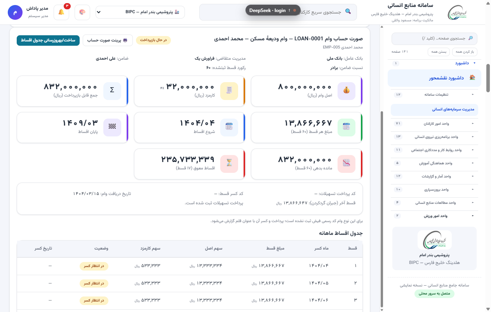
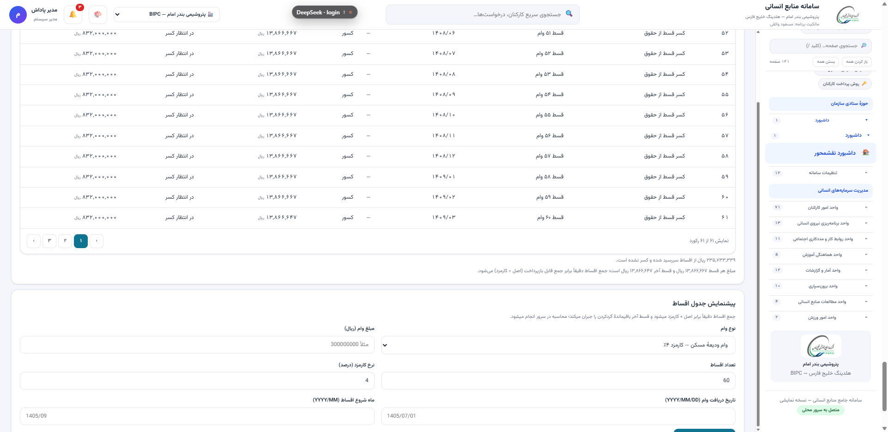

# اسپک صورت حساب و اقساط وام (پرداخت یکباره، جدول اقساط ماهانه، کسور فیش، مانده بدهی)

> سند مرجع این قابلیت است. هر بند شناسه‌دار (LOAN-xx) با آزمون یا فایل متناظر خودش در
> `tools/check/loan-spec.mjs` و `make verify` ردیابی می‌شود؛ بند بی‌تأیید یا آزمون یتیم،
> دروازه را می‌شکند.

---

## ۱. مسئله

کاربر: «در بخش وام، خودِ وام یک بار پرداخت می‌شود و بعد میزان اقساط ماهیانه بر اساس تعداد
اقساط ماهیانه باید کسر گردد و در فیش و صورت حساب وام‌ها دیده شود. در صورت حساب وام‌ها،
صورت کامل وام تخصیص‌یافته، تاریخچهٔ وام، میزان اقساط، کارمزد و مانده بدهی باید قابل
گزارش‌گیری باشد.»

سه کاستی که این سند رفع می‌کند:

1. **پرداخت و کسر جدا نبودند**: رکورد وام مبلغ و «تعداد اقساط» را داشت ولی هیچ‌جا اقساط
   ماهانه ساخته نمی‌شد؛ پس نه معلوم بود چه ماهی چقدر کسر می‌شود و نه مانده بدهی.
2. **فیش از وام بی‌خبر بود**: کدهای رسمی ۵۰۰/۵۰۲/۵۱۹/۵۰۳ (پرداخت وام) و ۵۴۰۰/۵۴۰۲
   (کسر اقساط) در جدول کدها بودند ولی هیچ موتوری سطر وام را به فیش نمی‌آورد.
3. **صورت حساب نبود**: مانده بدهی، کارمزد و تاریخچه در یک پاسخ قابل گزارش وجود نداشت.

---

## ۲. طراحی (قاعده در قواعد، داده در ماژول وام، نمایش در رابط)

| لایه | جا | کار |
| --- | --- | --- |
| قواعد | `server/internal/rules/loan.go` | شرایط وام، جدول اقساط ماهانه، مانده بدهی، تاریخچه، نگاشت کد رسمی |
| دامنه و API | `server/internal/modules/loans_retirement/` | شکل رکورد وام/قسط، اعتبارسنجی، مسیرهای صورت حساب و جدول اقساط، منبع گزارش |
| فیش | `server/internal/modules/payroll/loans.go` | بلوک اقساط وام در پاسخ فیش و کسر واقعی از خالص |
| رابط | `design/prototype/js/live_loans.js` | صفحهٔ «صورت حساب وام‌ها» (شرایط، جدول اقساط، تاریخچه، مانده) |

**قاعده‌های محاسبه یک‌جا در `rules` است** و هم ماژول وام (صورت حساب) و هم ماژول حقوق
(کسر قسط) از همان می‌خوانند؛ پس صورت حساب و فیش هرگز دو عدد متفاوت نشان نمی‌دهند.

### ۲٫۱ گردش وام

```
درخواست → امتیازبندی → تأیید → پرداخت تسهیلات (یک بار، ماه پرداخت)
        → بازپرداخت: کسر قسط ماهانه به تعداد اقساط → تسویه
```

- **پرداخت یک‌باره**: در ماه `receivedDate` به اندازهٔ اصل وام، یک سطر بستانکار با کد
  رسمی نوع وام (۵۰۰/۵۰۲/۵۱۹/۵۰۳) در صورت حساب و در فیش دیده می‌شود.
- **کسر ماهانه**: از ماه `firstPeriod` (خالی ⇒ ماه بعد از پرداخت)، هر ماه یک قسط.
  مبلغ هر قسط = `(اصل وام + کارمزد) ÷ تعداد اقساط` با **جبران باقیماندهٔ گردکردن در قسط
  آخر**؛ پس جمع اقساط دقیقاً برابر جمع قابل بازپرداخت می‌شود.
- **مانده بدهی** = جمع قابل بازپرداخت − اقساط کسرشده − تسویهٔ ثبت‌شده.

### ۲٫۲ مدل داده (رکوردها)

رکورد «درخواست وام» (`loans`) فیلدهای تازه می‌گیرد:

| فیلد | معنا |
| --- | --- |
| `firstPeriod` | ماه شروع کسر اقساط (YYYY/MM)؛ خالی ⇒ ماه بعد از تاریخ پرداخت |
| `settledAmount` / `settleDate` | مبلغ و تاریخ تسویهٔ پیش از موعد |
| `installmentAmount` / `feeAmount` | از قواعد پر می‌شوند (کارمزد از نرخ × اصل، قسط از تعداد) |

رکورد «قسط وام» (`loanInstallments`) از یک سطر بی‌پیوند به **ردیف جدول اقساط** تبدیل می‌شود:

| فیلد | معنا |
| --- | --- |
| `loan` | شناسهٔ وام پایه (LOAN-xxxx) |
| `seq` | شمارهٔ قسط |
| `period` | ماه کسر (YYYY/MM) |
| `principal` / `fee` | سهم اصل و سهم کارمزد در همین قسط |
| `amount` | مبلغ قسط (اصل + کارمزد) |
| `paidDate` / `method` | تاریخ کسر و روش پرداخت (حقوق/نقدی/بانکی) |

### ۲٫۳ کدهای رسمی

| نوع وام | کد پرداخت (بستانکار) | کد کسر قسط (کسور) |
| --- | --- | --- |
| وام اضطراری | ۵۰۰ | ۵۴۰۰ |
| وام پس‌انداز | ۵۰۲ | ۵۴۰۲ |
| وام مددکاری | ۵۱۹ | — |
| وام شرکتی (دوبرابر حقوق) | ۵۰۳ | — |
| ودیعهٔ مسکن و متمم، بانکی، فوت بستگان، حوادث مترقبه | — | — |

کد نداشتن یک نوع وام **پنهان نمی‌شود**: در صورت حساب و در پاسخ API فهرست صریح
«انواع وام بدون کد رسمی» برمی‌گردد تا مکاتبه با مالی معلوم باشد.

### ۲٫۴ کسر در فیش

پاسخ مسیر یکپارچهٔ فیش یک بلوک `loans` می‌گیرد (هر وام با شرایط، قسط همین دوره، مانده
بدهی و کد رسمی) و **جمع اقساط همان دوره** به «سایر کسور» موتور می‌رود؛ بنابراین مبلغ از
خالص کم می‌شود و در همان حال سطرهای وام کنار فیش قابل دیدن و چاپ است. موتورهای نظام
پرداخت دست‌نخورده می‌مانند (همه `otherDeductions` را می‌پذیرند).

---

## ۳. بندهای نیازمندی

| شناسه | نیازمندی | پیاده‌سازی | تأیید |
| --- | --- | --- | --- |
| LOAN-01 | شرایط وام محاسبه شود: جمع قابل بازپرداخت = اصل + کارمزد، مبلغ هر قسط از تعداد اقساط، قسط آخر جبران‌کنندهٔ گردکردن؛ مبلغ کمتر از یک ریال یا اقساط صفر رد شود. | `rules/loan.go` | go:TestLOAN01LoanTerms |
| LOAN-02 | جدول اقساط ماهانه ساخته شود: ماه‌شماری شمسی با گذر سال، شروع از ماه مشخص، پذیرش ارقام فارسی، ماه نامعتبر رد، تقسیم اصل و کارمزد روی هر قسط. | `rules/loan.go` | go:TestLOAN02Schedule |
| LOAN-03 | مانده بدهی و اقساط باقیمانده از جدول و پرداخت‌های ثبت‌شده حساب شود؛ تسویهٔ کامل و پرداخت بیش از موعد پشتیبانی گردد. | `rules/loan.go` | go:TestLOAN03Balance |
| LOAN-04 | هر نوع وام به کد رسمی فیش (پرداخت یک‌باره و کسر قسط) نگاشت شود و انواع بدون کد رسمی صریح گزارش شوند. | `rules/loan.go` | go:TestLOAN04PayslipCodes |
| LOAN-05 | شکل رکورد وام و قسط گسترش یابد و اعتبارسنجی دامنه مبلغ قسط و کارمزد را از قواعد پر کند و ورودی نامعتبر (ماه شروع، تعداد، مبلغ) را فیلدبه‌فیلد رد کند. | `modules/loans_retirement/domain/descriptor.go` | go:TestLOAN05Validation |
| LOAN-06 | تاریخچهٔ وام ساخته شود: پرداخت یک‌باره، اقساط (کسرشده/در انتظار/معوق)، تسویه، با ماندهٔ جاری پس از هر رخداد. | `rules/loan.go` | go:TestLOAN06History |
| LOAN-07 | API صورت حساب یک وام، کارتابل صورت حساب‌ها، پیش‌نمایش جدول اقساط و ساخت/به‌روزرسانی جدول اقساط (تکرارپذیر، بدون سطر تکراری) ارائه شود. | `modules/loans_retirement/api/loan_statement.go` | go:TestLOAN07Statement |
| LOAN-08 | در فیش، بلوک `loans` با قسط همین دوره و مانده بدهی بیاید و جمع اقساط دوره واقعاً از خالص کم شود؛ فهرست اقساط دوره برای پردازش حقوق هم در دسترس باشد. | `modules/payroll/loans.go` | go:TestLOAN08PayslipDeduction |
| LOAN-09 | صورت حساب و اقساط قابل گزارش‌گیری باشند: اقلام «مانده بدهی، اقساط باقیمانده، مبلغ قسط، کارمزد، جمع بازپرداخت، کد وام» روی منبع گزارش وام و منبع تازهٔ «اقساط وام‌ها» با جمع‌های خلاصه. | `modules/loans_retirement/report.go` | go:TestLOAN09Report |
| LOAN-10 | صفحهٔ «صورت حساب وام‌ها» با انتخاب کارمند/وام، کارت شرایط، جدول اقساط، تاریخچه و دکمهٔ تولید جدول و کسر قسط ارائه شود (با کامپوننت RN متناظر و بازتولید خروجی‌ها). | `design/prototype/js/live_loans.js` | go:TestLOAN10ScreenRegistered |

---

## ۴. راستی‌آزمایی زنده (سرور محلی `127.0.0.1:8099`، دادهٔ واقعی پایگاه‌دادهٔ `hrms_ops`)





| سنجه | نتیجهٔ دیده‌شده |
| --- | --- |
| `GET /api/v1/loans/statements?period=1405/09` | ۱۰ وام، جمع اصل ۲٬۰۲۰٬۰۰۰٬۰۰۰ ریال، جمع مانده بدهی ۲٬۱۶۳٬۶۰۰٬۰۰۰ و کسر ماه ۲۶٬۱۵۸٬۳۳۴ ریال؛ ۵ نوع وام بدون کد رسمی صریح گزارش شد |
| `POST /api/v1/loans/LOAN-0001/schedule` | بار اول ۶۰ قسط ساخته شد؛ بار دوم `created=0, unchanged=60` (تکرارپذیر) |
| `GET /api/v1/loans/statement?id=LOAN-0001` | اصل ۸۰۰٬۰۰۰٬۰۰۰ + کارمزد ۳۲٬۰۰۰٬۰۰۰ = ۸۳۲٬۰۰۰٬۰۰۰؛ هر قسط ۱۳٬۸۶۶٬۶۶۷ و قسط آخر ۱۳٬۸۶۶٬۶۴۷؛ اقساط ۱۴۰۴/۰۴ تا ۱۴۰۹/۰۳؛ تاریخچه ۶۱ رخداد (پرداخت + ۶۰ قسط) |
| `GET /api/v1/loans/installments-due?period=1404/04` | یک قسط در انتظار کسر، ۱۳٬۸۶۶٬۶۶۷ ریال، با پیوند به وام و مانده بدهی |
| `POST /api/v1/payroll/payslip` (EMP-005، ۱۴۰۴/۰۴) | ناخالص ۱۴۷٬۱۲۵٬۰۰۰ → خالص ۱۲۴٬۴۳۰٬۸۳۳؛ بلوک `loans` یک سطر با قسط همین ماه و یادداشت «جمع اقساط وام این ماه به سایر کسور افزوده شد» |
| صفحهٔ «صورت حساب وام‌ها» | ۵ کارت جمع، جدول ۱۰ وام با مانده بدهی و قسط بعدی، صورت حساب کامل (شرایط، جدول ۶۰ قسط، تاریخچهٔ ۶۱ رخداد با ماندهٔ جاری) و فرم پیش‌نمایش جدول اقساط |

---

## ۵. کارهای باز (آگاهانه)

1. **کدهای رسمی ناقص**: برای ودیعهٔ مسکن، متمم، بانکی، فوت بستگان درجه یک و حوادث مترقبه
   در جدول رسمی کد پرداخت/کسر قسط ثبت نشده؛ نگاشت خالی می‌ماند و صریح گزارش می‌شود.
2. **همپوشانی با تخصیص فوق العاده**: کد ۵۴۰۰ در جدول تخصیص هم قابل انتخاب است؛ اگر هم
   تخصیص دستی و هم جدول اقساط برای یک وام فعال باشد، ممکن است دو بار کسر شود. یکپارچه
   کردن این دو مسیر کار بعدی است.
3. **کسر خودکار در پردازش حقوق**: اکنون فیش یکتک‌نفره قسط را کسر می‌کند؛ اعمال گروهی روی
   همهٔ کارکنان در یک دورهٔ حقوق (و علامت‌زدن اقساط به‌عنوان کسرشده) موضوع کار بعدی است.
4. **دیرکرد و جریمهٔ تأخیر**: وضعیت «معوق» نمایش داده می‌شود ولی جریمهٔ دیرکرد محاسبه نمی‌شود.
