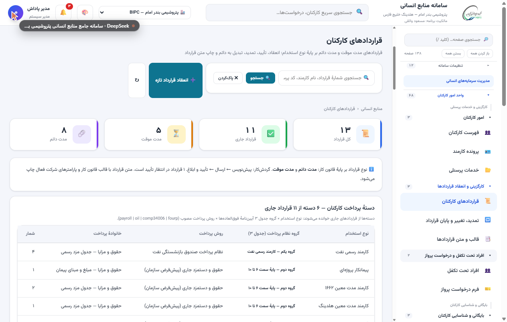
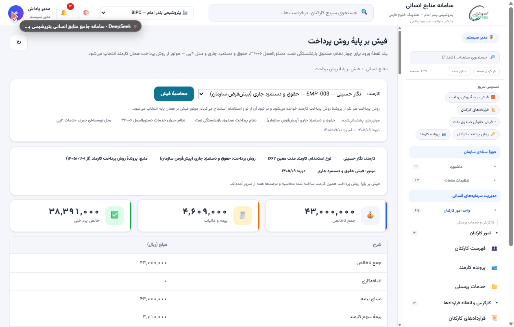

# اسپک دستهٔ پرداخت: گروه جدول ۳، روش‌های پرداخت و جداسازی نظام‌ها

> نسخهٔ ۱.۰ — ۱۴۰۵/۰۹/۰۲
> دامنه: نظام پرداخت صندوق نفت (`rules/oilpay*`)، قراردادها، احکام کارگزینی، فیش حقوق و
> دو مدل جبران خدمات (۴پی و جی‌بیست).
> روش: **spec-driven** — بندهای `PAY-xx` همین سند با دروازهٔ `node tools/check/pcs-spec.mjs`
> (و `make verify`) ردیابی می‌شوند.

---

## ۱. مسئله و تصمیم‌ها

سه چیز باید روشن و ثبت‌شده باشد تا «هر نفر با توجه به نوع قرارداد و روش پرداختش دسته‌بندی
شود» و حکم و فیش بر همان مبنا ساخته شوند:

1. **گروه نظام پرداخت نفت** (جدول ۳ آیین‌نامهٔ فوق‌العاده‌ها): پیش از این «کارمند رسمی نفت»
   با پایهٔ سمت ۶ تا ۱۰ در یک گروه شمرده می‌شد و مصوبهٔ جدا برای رسمی‌های نفت ممکن نبود.
   حالا:
   - **گروه یکم** = کارمند رسمی نفت (گروه مستقل، بدون پایهٔ سمت)
   - **گروه دوم** = پایهٔ سمت ۶ تا ۱۰ (همان «گروه یکم» پیشین)
   - گروه سوم تا دهم = پایه‌های سمت ۱۱–۱۵، ۱۶، ۱۷، A، B، C، D، OD
   درصدهای هر گروه پارامتری است: `oilpay.group.<شماره>.public|rank`.
2. **روش پرداخت** (چهار روش مصوب سامانه، بدون تغییر کلیدها): `payroll` (حقوق و دستمزد
   جاری)، `oil` (صندوق بازنشستگی نفت)، `comp34006` (دستورالعمل ۳۴۰۰۶)، `fourp` (۴پی).
   فهرست از ماژول حقوق به بستهٔ مشترک `rules` منتقل شد تا قرارداد و حکم هم بتوانند آن را
   اعتبارسنجی کنند بدون شکستن مرز ماژول.
3. **جداسازی دو مدل جبران خدمات**: نظام ۴پی و نظام جی‌بیست (G20) کاملاً منفک شدند.

**ثبت در سند:** `hr_contracts.contract` و `hr_salary_admin.decree` هر دو ستون `pay_group`
(شمارهٔ گروه) و `pay_model` (کلید روش) گرفتند؛ پس «دستهٔ پرداخت» هر نفر روی سند می‌ماند و
قابل بازبینی و بازتولید است.

---

## ۲. بندهای نیازمندی

| شناسه | نیازمندی | پیاده‌سازی | تأیید |
| --- | --- | --- | --- |
| PAY-01 | «کارمند رسمی نفت» از گروه یکم جدا شود، گروه یکم مستقل و بی‌پایهٔ سمت باشد، «گروه یکم» پیشین به گروه دوم (پایهٔ سمت ۶ تا ۱۰) و بقیه یک پله جابه‌جا شوند. | `rules/oilpay_group.go` | go:TestPAY01OilPayGroupsRenumbered |
| PAY-02 | گروه نهایی هر نفر از نوع استخدام (رسمی نفت ⇒ گروه یکم)، سپس پایهٔ سمت و در نبود آن از گروه شغلی سازمان تعیین شود و درصدهای هر گروه با پارامتر شرکت جدا بازنویسی‌شدنی باشد. | `rules/oilpay_group.go`، `modules/payroll/oilpay.go` | go:TestPAY02GroupResolution |
| PAY-03 | چهار روش پرداخت مصوب سرجای خود بمانند و سازگاری نوع استخدام با روش پرداخت اعمال شود (رسمی نفت فقط `oil`، `oil` فقط برای رسمی نفت، دو مدل توسعه‌ای با انتخاب صریح). | `rules/paymodel.go` | go:TestPAY03PayModelsCatalogAndRules |
| PAY-04 | قرارداد، گروه و روش پرداخت را ثبت و برمی‌گرداند؛ فهرست هر دو از مسیر فرم‌ها می‌آید و ترکیب ناسازگار با ۴۲۲ رد می‌شود. | `modules/contracts/*`، `contracts/contract.go` | go:TestPAY04ContractPayClassification |
| PAY-05 | حکم کارگزینی هم همان دستهٔ پرداخت را می‌نویسد (رسمی نفت همیشه گروه یکم، مستقل از گروه شغلی) و ترکیب ناسازگار را رد می‌کند. | `modules/salary_admin/*`، `contracts/salary_admin.go` | go:TestPAY05DecreePayClassification |
| PAY-06 | گزارش «دستهٔ پرداخت کارکنان» بر پایهٔ (نوع استخدام × گروه جدول ۳ × روش پرداخت) با شمار و فهرست کارکنان هر دسته در دسترس باشد. | `modules/contracts/api/classification.go` | go:TestPAY06ClassificationReport |
| PAY-07 | کلید «کارمند رسمی نفت» در بستهٔ قواعد با فهرست انواع استخدام سامانه یکی بماند (ثبات بین ماژولی). | `rules/paymodel.go`، `contracts/employment.go` | go:TestPAY07OfficialOilKeyConsistency |
| PAY-09 | دستهٔ پرداخت روی قراردادهایی که ستون خالی دارند یک‌بار نوشته شود (عملیات مدیریتی، تکرارپذیر) و احکام تاریخی دست‌نخورده بمانند. | `modules/contracts/app/service.go`، `api/classification.go` | go:TestPAY09ClassificationBackfill |
| PAY-10 | یک نقطهٔ ورود برای فیش («فیش بر پایهٔ روش پرداخت») که موتور را از روش پرداخت همان کارمند انتخاب کند: صندوق نفت، ۳۴۰۰۶، حقوق و دستمزد جاری و مدل ۴پی (با موتور جاری و یادداشت)؛ روش پرداخت از پروندهٔ کارمند و در نبود آن از نوع استخدام تعیین شود و تحمیل روش ناسازگار رد گردد. | `modules/payroll/payslip.go`، `module.go` | go:TestPAY10PayslipDispatch |
| PAY-08 | نظام ۴پی و جی‌بیست کاملاً منفک شوند: هیچ پارامتر/تابع پیوندی نماند، پاسخ هر مدل فقط دادهٔ خودش را بدهد و تغییر پارامترهای یکی بر دیگری اثری نداشته باشد. | `rules/g20.go`، `modules/compensation/*` | go:TestG20DecoupleNoLinkParameter، go:TestG20DecoupleG20ParamsDoNotAffect4P، go:TestG20Decouple4PParamsDoNotAffectG20، doc:docs/pay-classification-spec-fa.md#جداسازی |

---

## ۳. جداسازی ۴پی و جی‌بیست (PAY-08)

- حذف `G20Params.PartnershipMaxFactor` (و تابع `G20PartnershipFactor` و هِلپر `round4`).
- پاسخ `/api/v1/compensation/options` دیگر هیچ دادهٔ G20 ندارد؛ `g20Families` و `g20Sources`
  از مسیر مالکشان `/api/v1/compensation/g20-options` می‌آید (فرم پیش‌نمونه هم به همان مسیر
  منتقل شد: `design/prototype/js/live_records.js`).
- خوانندهٔ پارامترهای ۴پی کلیدهای `compensation.g20.*` را نادیده می‌گیرد و برعکس.
- پارامتر مردهٔ `compensation.g20.partnership.maxFactor` از `contracts/organizations.json`
  حذف و خروجی‌های تولیدشده بازتولید شد.
- خانوادهٔ «پارتنرشیپ» به‌عنوان خانوادهٔ امتیاز درون G20 ماند، بی‌هیچ پیوندی با ۴پی.

---

## ۴. نمای رابط و اجرای واقعی

بخش «دستهٔ پرداخت کارکنان» در بالای صفحهٔ قراردادها: شمار کارکنان هر دسته با نوع استخدام،
گروه جدول ۳، روش پرداخت و خانوادهٔ پرداخت. کارت «دستهٔ پرداخت» (روش پرداخت + گروه) در
زیرفرم قرارداد هم نمایش داده می‌شود و برای کارمند رسمی نفت پیش‌فرض «صندوق نفت / گروه یکم»
می‌گیرد.

| سنجش زنده (سرور واقعی، ۲۰ قرارداد نمونه) | نتیجه |
| --- | --- |
| `GET /contracts/pay-classification` | ✅ ۶ دسته از ۱۱ قرارداد جاری |
| `POST /contracts/pay-classification/backfill` اجرای اول | ✅ ۱۳ سند به‌روز شد (رخداد در حسابرسی ثبت شد) |
| همان عملیات، اجرای دوم | ✅ `updated=0` (تکرارپذیر) |
| فرم قرارداد با نوع استخدام `official_oil` | ✅ روش پرداخت «صندوق نفت» و گروه «۱» پیش‌فرض؛ بدنهٔ ارسالی `payModel=oil, payGroup=1` |
| فرم قرارداد با نوع استخدام `contractor_staff` | ✅ پیش‌فرض «حقوق و دستمزد جاری» و فرادادهٔ پیمان در `payMeta` |
| فیش صندوق نفت کارمند رسمی نفت | ✅ `payGroup=1`، منبع «نوع استخدام (کارمند رسمی نفت)»، Y جدول ۳ = ۱۲٪ |
| `GET /payroll/payslip-defaults` | ✅ چهار موتور + روش پرداخت مؤثر هر کارمند با منبع آن |
| `POST /payroll/payslip` کارمند رسمی نفت (`EMP-001`) | ✅ موتور «فیش صندوق بازنشستگی نفت»، `payGroup=1`، ناخالص ۱۳۹٫۱ م / خالص ۱۱۶٫۹ م |
| همان مسیر برای کارمند غیررسمی (`EMP-003`) | ✅ موتور «حقوق و دستمزد جاری»: ناخالص ۴۳ م، بیمهٔ سهم کارمند ۳٫۰۱ م، مالیات ۱٫۶ م، خالص ۳۸٫۴ م |
| تحمیل `payModel=oil` برای کارمند غیررسمی | ✅ ۴۲۲ با پیام «نظام پرداخت صندوق بازنشستگی نفت تنها برای کارمندان رسمی نفت است.» |
| کارمند ناشناخته | ✅ ۴۰۴ |
| دادهٔ ناسازگار (پروندهٔ روش پرداخت ≠ نوع استخدام) | ✅ نادیده گرفته می‌شود، فیش با پیش‌فرض نوع استخدام ساخته می‌شود و هشدار فارسی در `notesFa` می‌آید (رکورد نمونهٔ `EMP-001` نیز اصلاح شد) |
| صفحهٔ «فیش بر پایهٔ روش پرداخت» در رابط | ✅ منوی ماژول حقوق، انتخاب کارمند با روش پرداخت هر نفر، سرصفحهٔ روش/منبع/موتور/دوره و فیش همان موتور (۱۳ کارمند، دو موتور در دو آزمایش) |

### ۴.۱ نمای رابط فیش یکپارچه

صفحهٔ تازهٔ `payByMethod` در مانیفست ماژول حقوق ثبت شد (با کامپوننت RN متناظر) و منو و
مستندات تولیدشده بازتولید شدند. صفحه: انتخاب کارمند → محاسبهٔ خودکار → سرصفحهٔ روش پرداخت و
منبع آن + فیش همان موتور (فیش صندوق نفت با جدول اقلام، ۳۴۰۶ با اقلام کددار، موتور جاری با
ناخالص/بیمه/مالیات/خالص) و هشدارهای سرور.

---

## ۵. ریسک‌ها و کارهای باز

1. **نمای رابط گزارش دسته‌بندی**: ساخته شد — بخش «دستهٔ پرداخت کارکنان» در بالای صفحهٔ
   قراردادها با شمار و نوع هر دسته؛ کارت «دستهٔ پرداخت» (روش پرداخت + گروه) هم در زیرفرم
   قرارداد نمایش داده می‌شود و برای رسمی نفت پیش‌فرض صندوق نفت/گروه یکم می‌گیرد.
2. **ثبت دائمی روی اسناد موجود**: با `POST /api/v1/contracts/pay-classification/backfill`
   انجام می‌شود (نقش تأییدکننده، تکرارپذیر). احکام گذشته عمداً بازنویسی نمی‌شوند.
3. **فیلد «پایهٔ سمت» در قرارداد نیست**: گروه قرارداد از نوع استخدام و در نبود آن گروه
   پیش‌فرض دوم می‌آید؛ گروه دقیق را حکم با دانستن گروه شغلی می‌نویسد.
4. **فیش یکپارچه «بر پایهٔ روش پرداخت»** ساخته شد: `POST /api/v1/payroll/payslip` با فهرست
   `GET /api/v1/payroll/payslip-defaults`. مسیرهای اختصاصی هر نظام (فیش صندوق نفت و فیش
   ۳۴۰۰۶) دست‌نخورده مانده‌اند و فرم‌های تخصصی خودشان را دارند.
5. **مدل ۴پی و جی‌بیست در فیش**: ۴پی با موتور جاری پرداخت می‌شود و تصمیم/کارنامه‌اش در ماژول
   جبران خدمات می‌ماند؛ جی‌بیست مدل امتیازدهی است و فیش نمی‌سازد (بند PAY-08).
6. **نمای رابط فیش یکپارچه** ساخته شد: صفحهٔ `payByMethod` در مانیفست ماژول حقوق با
   کامپوننت `PayByMethodScreen` در اپ موبایل و صفحهٔ زندهٔ `live_oilpay.js` در رابط وب.
   صفحهٔ اختصاصی «فیش حقوقی صندوق نفت» هم دست‌نخورده مانده است (فرم تخصصی همان نظام با
   ضرائب قابل ویرایش).
7. **سقف نقاط پرخطر فرانت‌اند** با همین کار پایین‌تر آمد: ۱۳ نقطهٔ `innerHTML = ''`
   (خالی‌کردن ظرف) به `replaceChildren()` و یک پیام ثابت به `textContent` منتقل شد؛
   سقف ratchet از ۱۳۵ به **۱۲۷** رسید.
